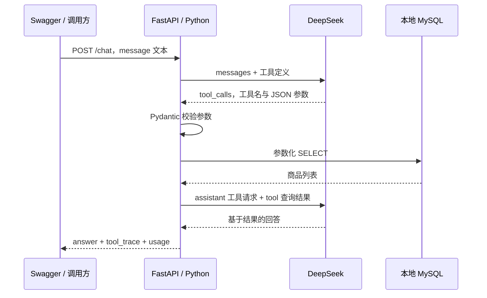

# 第二步：FastAPI + 一个商品查询工具

> 本文保留第二步当时的代码讲解。第三步已按职责拆分模块：参数定义移到schemas.py，数据库连接/SQL移到storage.py，HTTP调用移到llm.py，提示词移到prompts.py。当前结构和多轮调用方法见[第三步](03-multi-turn-state.md)。

日期：2026-10-16（北京时间）。前置：第一步已真实调用 DeepSeek。

## 本步目标

输入一句找商品需求，模型生成 `search_products` 调用，Python 查询 MySQL，把商品交回模型解释。本步只处理单轮纯文本；多轮记忆留到第三步。

FastAPI 是 HTTP 入口，通过自动生成的 Swagger 页面测试，无需写前端。`/health` 只证明服务启动，不代表数据库和模型可用。



## 文件阅读顺序

| 文件 | 职责 | 阅读重点 |
| --- | --- | --- |
| `app/main.py` | FastAPI 入口 | 请求校验、POST /chat |
| `app/products.py` | 工具参数与 MySQL 查询 | SearchProductsArgs、参数化 SQL |
| `app/agent.py` | 模型与工具的执行循环 | TOOL、tool_calls、role=tool |
| `app/config.py` | 本地配置 | 环境变量优先、范围校验 |
| `seed_products.py` | 显式初始化练习数据 | 专用库、整数分、不覆盖已有 SKU |
| `tests/test_step2.py` | 隔离模型/数据库的行为测试 | 不产生 API 费用 |
| `verify_step2.py` | MySQL + DeepSeek 真实验收 | 匹配、无结果、累计用量 |

第一步的 first_call.py 保留用于对照。第二步增加工具契约、校验、执行和回传，不引入 Agent 框架。

## 配置与启动

`.env.dev` 已追加以下字段。按 Navicat 核对连接，在本地填密码并保存，不把密码发到聊天。

```dotenv
MYSQL_HOST=127.0.0.1
MYSQL_PORT=3306
MYSQL_USER=root
MYSQL_PASSWORD=
MYSQL_DATABASE=agent_goods_practice
AGENT_MAX_MODEL_CALLS=3
DEEPSEEK_TIMEOUT_SECONDS=60
DEEPSEEK_MAX_TOKENS=700
```

进程环境变量优先于 .env.dev；模型继续由 DEEPSEEK_MODEL 指定。

```powershell
.\.venv\Scripts\python.exe -m pip install -r requirements.txt
.\.venv\Scripts\python.exe seed_products.py
.\.venv\Scripts\python.exe -m uvicorn app.main:app --reload --host 127.0.0.1 --port 8000
```

初始化脚本只允许 agent_goods_practice，创建 products 表和 28 条标记为“练习数据”的商品：24 条签字笔、4 条橡皮。不会删表、清空数据或更新已有 SKU。API 启动不自动写入数据。没有建库权限时，可在 Navicat 创建同名库并赋予本地用户相应权限后重试。

价格以整数分保存，150 表示 1.50 元；库存按 unit 计，本课不处理盒与支的换算。

## 关键代码：结合前端经验理解

### 1. FastAPI 路由和请求模型

```python
@app.post('/chat')
def chat(body: ChatRequest):
    return run_agent(body.message)
```

ChatRequest 类似请求体类型声明，但 Pydantic 会在运行时校验：message 去空白后长度为 1—1000，拒绝额外字段；非法输入返回 422。同步 def 让 FastAPI 在线程池运行同步 HTTP/MySQL 操作。

### 2. 工具定义不是直接执行函数

TOOL 提供工具名、用途和 JSON Schema。模型返回的 arguments 是 JSON 字符串，先用 SearchProductsArgs.model_validate_json 校验，再调用函数。禁止额外字段、负价格、越界 limit，不执行模型提供的 Python 或 SQL。

参数包括 brand、category、color、spec、keyword、max_price_fen、limit。品牌/规格等精确匹配，keyword 只匹配名称，默认返回 5 条，最多 10 条有库存商品。预算换算：5 元=500 分。

### 3. SQL 参数绑定

```python
clauses.append('brand = %s')
values.append(args.brand)
cursor.execute(sql, values)
```

%s 是驱动参数占位符，不能自己拼入用户值。列名来自代码白名单，条件通过 AND 同时满足；查无结果不自动放宽条件。数据库连接在查询后关闭，不跨模型请求持有事务。

### 4. 工具结果回传是核心

```python
messages.append({'role': 'assistant', 'content': ..., 'tool_calls': calls})
messages.append({
    'role': 'tool',
    'tool_call_id': call['id'],
    'content': json.dumps(result, ensure_ascii=False),
})
```

tool_call_id 对应模型提出的那次调用。第二次请求带上实际查询结果，模型才知道查到了哪些商品。模型提出调用意图，Python 负责执行。

模型也可以追问。商品查询应出现 tool_trace；提示词不能保证所有回答永远正确，学习时对照参数和商品结果检查。

默认最多 3 次模型请求，最后一次 tool_choice=none 只总结或追问；每轮最多 3 个工具调用。网络错误、参数非法、输出截断时停止并返回 503，不自动重试；错误恢复在后续步骤深入。

## 手动验收

访问 http://127.0.0.1:8000/docs，展开 POST /chat，点击 Try it out，输入：

```json
{"message":"找得力黑色0.5mm签字笔，单价不超过5元。请查询并解释候选。"}
```

检查 tool_trace 中筛选条件和 products，再核对 answer 中 SKU、价格与匹配原因。usage 是多次模型调用累计 Token；一次 HTTP 请求通常包含两次模型调用，第二次输入包含查询结果。

再试预算 0.01 元：应真实查询后返回空候选，并明确说明无结果。数据库失败不能伪装成没有商品。

每次 /chat 重新构造 messages，现在不支持“换晨光，其他不变”；下一步学习需求状态。

```powershell
# 单元测试：不访问模型或数据库
.\.venv\Scripts\python.exe -m unittest discover -s tests -v
# 真实验收：访问 MySQL 和模型，会产生 API 费用
.\.venv\Scripts\python.exe verify_step2.py
```

## 验证与实际排错记录

- Python 3.14.2，新增依赖安装成功；pip check 通过。
- 四项单元测试通过：非法工具参数、空请求不调用模型、工具结果按 ID 配对、未知工具不执行。
- Uvicorn 在 127.0.0.1:8000 启动成功；真实 HTTP GET /health 返回 status=ok、step=2，/docs 返回 200。
- 首次测试夹具重复进入 httpx.Client，报 Cannot open a client instance more than once；改为只让业务函数管理上下文后通过。
- Starlette 1.8.0 的 TestClient 提示当前 httpx 用法弃用，固定为 Starlette 0.52.1 后测试无该警告。
- PowerShell 管道复制文档时中文文件名被编码成问号；改为 ASCII 文件名并原样复制 UTF-8 内容。
- 文档批量补丁包含同一路径删除和新增，校验拒绝，未发生修改；改为更新原文件。
- 真实数据库与官方工具调用：已通过，具体结果见下方。

### 最终真实验收（2026-10-16）

第一次初始化在 MySQL 登录阶段返回 1045。仅检查配置是否非空，确认磁盘上的 MYSQL_PASSWORD 仍为空，未输出密码或原始异常。用户在本地保存后重试成功；此前未建库或写入商品。

`seed_products.py` 初始化 28 条商品；重复执行后仍为 28 条，确认没有重复插入。

`verify_step2.py` 退出码 0，实际连接本地 MySQL 和 DeepSeek 官方接口。参数化 SQL 条件查询通过，注入测试字符串仅作为品牌值处理并返回空结果。FastAPI 空文本请求返回 422。

| 测试输入 | 工具结果 | 模型请求次数 | 输入 Token | 输出 Token | 总 Token | 耗时 |
| --- | --- | --- | --- | --- | --- | --- |
| 得力黑色0.5mm签字笔，预算5元 | DEMO-PEN-0000，150分/支，库存30支 | 2 | 1865 | 290 | 2155 | 2.99秒 |
| 同条件，预算0.01元 | 0条，未放宽条件 | 2 | 1778 | 294 | 2072 | 3.23秒 |

模型回答中的 SKU、单价与工具返回一致；无结果回答明确保留全部筛选条件。

本地服务在配置保存前启动，可能缓存旧环境变量，因此重启了本课 Uvicorn 服务以加载新配置。真实网络 `POST http://127.0.0.1:8000/chat` 返回 200，查询到同一商品，回答单价1.50元。该次请求内部调用模型2次，输入1861、输出219、合计2080 Token，耗时2.75秒。`/docs` 可继续手动调试。

结论：第二步完整通过。以上仅是本次指定样例的验证，未证明任意自然语言都能正确抽取条件；完整错误恢复与评测仍按后续计划学习。

## 补充理解：数据库什么时候连接、查询和关闭

MySQL 是独立运行的服务；Navicat 与 Python 都是它的客户端。Navicat 不需要一直打开，Python 通过 PyMySQL 自己建立连接。

导入 app/config.py 时，load_dotenv 只读取本地配置，不登录 MySQL。导入 connect 或定义函数也不会执行其函数体。启动 Uvicorn、打开 /docs、访问 /health 都不会连接数据库。

存在两条执行路径：

1. 手动运行 seed_products.py：底部入口调用 seed() → connect(with_database=False) 连接 MySQL 服务，暂不选库 → CREATE DATABASE → USE agent_goods_practice → CREATE TABLE → SELECT 检查 SKU → INSERT 缺失商品 → commit 提交写入 → SELECT 统计 → 离开 with 关闭连接。初始化后商品保存在 MySQL 中，重启 Python 不会丢失，不必每次启动都初始化。
2. 调用 POST /chat：路由调用 run_agent → 第一次请求 DeepSeek → 模型返回 search_products 工具请求 → 校验参数 → 执行 search_products(args) → connect() 连接并选中练习库 → cursor.execute(sql, values) 执行 SELECT → fetchall() 获取结果 → 离开 with 关闭连接 → 把商品结果交回 DeepSeek → 返回回答。如果模型直接追问且不调用工具，本轮不查询数据库。

connect() 内的 pymysql.connect 使用 host、port、user、password 建立网络连接和鉴权，database 指定选用的库，DictCursor 让查询结果每行表现为字典。连接成功不等于已经查询商品，真正执行商品 SQL 的位置是 cursor.execute。

```python
with connect() as connection:              # 建连接，选库
    with connection.cursor() as cursor:    # 创建执行 SQL 的对象
        cursor.execute(sql, values)        # 发出并执行查询
        return list(cursor.fetchall())     # 取回全部结果；返回前仍会退出 with
```

核对当前安装 PyMySQL 的 Connection.__exit__，它调用 close()，不会自动 commit。初始化写入由 seed() 显式 commit；商品 SELECT 路径没有写入，无需提交写入。with 在正常返回或异常时都负责退出并关闭已建立的连接。

本课没有连接池；每次执行 search_products 都新建并关闭一条连接。一轮 Agent 若执行多次工具，就会建立多次连接；不是每次模型请求都查库。第二次请求模型解释结果时，数据库连接已经关闭。

可在 VS Code 设置断点观察：app/main.py 的 run_agent 调用处、app/agent.py 的 search_products(args) 调用处、app/products.py 的 pymysql.connect 和 cursor.execute 处。启动服务不会停在数据库断点；找商品请求生成工具调用后才会停。调试时不要把包含本地凭据的变量截图或复制到聊天。

本轮仅阅读与核对代码、补充说明，未执行初始化或付费模型调用，没有新增运行报错。

### 参考链接

### agent.py 第45行之后：条件、校验与返回格式

#### 先看懂 API 响应外壳

本项目使用非流式 Chat Completions。响应顶层的usage由API服务统计本次请求用量；choices[0].message保存第一条模型消息，包含content和可能出现的tool_calls。它不是一整段纯文本，也不是让模型在回答里自己计算Token。

简化的工具请求响应示例（数字和ID仅为教学示意）：

```json
{
  "choices": [{
    "message": {
      "role": "assistant",
      "content": null,
      "tool_calls": [{
        "id": "call_demo",
        "type": "function",
        "function": {
          "name": "search_products",
          "arguments": "{\"brand\":\"得力\",\"max_price_fen\":500}"
        }
      }]
    },
    "finish_reason": "tool_calls"
  }],
  "usage": {"prompt_tokens": 100, "completion_tokens": 20, "total_tokens": 120}
}
```

本地usage是单次/chat请求的累计器，在模型循环前初始化为三个0。for name in usage遍历字典键，不遍历Token。第一次name=prompt_tokens，因此count=data['usage']['prompt_tokens']=100，再执行usage['prompt_tokens']+=100；其他两项相同。非负整数检查只验证统计值合理。下一次模型响应的三个计数继续累加；新/chat请求重新从0开始，不是账户总用量。

例如第一次100输入+20输出=120总数，第二次180输入+30输出=210总数，累计280输入、50输出、330总数。第二次输入包括再次发送的消息、工具说明和工具结果，所以两次输入不是同一批文本只计一次。

message.get('tool_calls')取得协议字段；字段缺失、为null或空列表时，or []统一为[]，if not calls成立。有非空工具调用列表时if not calls不成立，进入工具执行分支。它没有扫描content文本，也没有猜测模型是否想调用工具。示例里的calls就是一个包含call_demo工具请求字典的列表。

传入tools让API知道可调用工具，tool_choice=auto允许模型回答或产生工具请求，不保证每轮必有调用。工具请求中name与arguments只是调用意图；后端校验参数并执行自己的Python函数，模型不知道本地数据库密码，也不直接连接数据库。正常最终回答通常在content中，tool_calls缺失或为空，finish_reason为stop。

官方依据：https://api-docs.deepseek.com/api/create-chat-completion/ 。本轮核对官方响应字段与本地循环代码，未新增数据库操作、收费模型调用或运行错误。

问题示例：找得力黑色0.5mm签字笔，单价不超过5元。TOOL.parameters 由 SearchProductsArgs.model_json_schema() 生成，告诉模型可用字段和类型；SYSTEM 告诉它保留条件并把元转换为分。模型生成 search_products 的 arguments JSON字符串，如 category=签字笔、brand=得力、color=黑色、spec=0.5mm、max_price_fen=500。

client.post 发送本轮 messages 与工具定义，raise_for_status 检查HTTP失败；response.json 解析响应，choices[0].message取得第一条消息，usage累计本轮Token。tool_calls为空则读取非空content并返回给调用方；输出被截断或工具调用越界则停止。

有工具调用时先保存assistant工具请求，遍历每个call，只接受固定search_products名称；model_validate_json解析并校验arguments。校验包括拒绝额外字段、严格类型、价格范围和limit边界，失败后不执行该次查询。验证只能保证参数形状和范围，不能保证品牌没有遗漏、预算没有换算错；当前这部分靠提示词及样例验证，尚未实现确定性语义核对。

search_products把非空字段映射到固定SQL：category/brand/color/spec精确相等，keyword用LOCATE包含匹配，max_price_fen用<=，固定stock>0，加ORDER BY price_fen,sku和LIMIT。SQL返回列由SELECT固定为sku,name,category,brand,color,spec,unit,price_fen,stock；值用%s绑定，模型不提供SQL。

DictCursor将每行变成字段名到值的字典，fetchall得到商品集合；空结果是[]。Python构造result={practice_data:True,products:商品列表,returned_count:条数}。trace用于给调用方观察执行记录，其中args.model_dump(exclude_none=True)把校验对象转成字典，**result把结果字段展开合并。

messages添加role=tool消息，tool_call_id对应模型call.id，content通过json.dumps变成JSON字符串；ensure_ascii=False保留中文。这里append只修改本地消息列表，到下一次for循环client.post才真正交回DeepSeek。模型取得结果后生成content，再走无工具分支返回。

当前返回字段由SQL列、数据库结构、驱动和Python字典构造维持一致，尚未对模型完整响应或FastAPI最终响应定义独立的完整Pydantic输出模型；模型回答仍是自由文本。HTTP成功也不代表所有字段都合规，代码另外检查或在读取异常时停止。

本轮仅做离线Pydantic参数演示：合法brand/color/spec/预算通过，缺省limit补5；limit=99、额外sql字段、字符串价格均被拒绝。未查询数据库或调用收费模型，没有新增报错。

### seed_products.py 阅读补充

这个脚本用于准备练习库，不参与每次 /chat 商品查询。执行顺序从底部入口开始：确认 __name__ 为 __main__ → 设置 UTF-8 输出 → 计算打印内容里的 seed() → 初始化完成后打印数量。导入这个模块时，入口不执行。

`from app.products import connect` 只导入函数；执行到 `with connect(with_database=False) as connection` 才调用函数并建立连接。`with_database=False` 是因为首次执行时库可能还不存在，先连 MySQL 服务，再 CREATE DATABASE、USE 选库和 CREATE TABLE。函数签名中的 * 表示 with_database 要用关键字传参。

cursor 是发送 SQL、获取结果的对象；每次 cursor.execute 才真正执行一条 SQL。CREATE DATABASE 和 CREATE TABLE 使用 IF NOT EXISTS，已有库表不会重新创建；它也不会自动迁移已有表结构。

rows 列表只在 Python 内存中生成数据，append 不会写数据库。三品牌×两颜色×两规格×两款=24条签字笔；再加4条橡皮，共28条。enumerate 同时取得编号与名称，编号拼进SKU；每个元组按表字段顺序保存。价格150代表1.50元，stock=30是30支。

最后遍历 rows，对每个 SKU 执行 SELECT，fetchone 取一行；不存在时才 INSERT，存在时跳过，因此重复运行不会重复添加这些SKU，也不会覆盖修改过的价格。占位符%s与参数元组分开传入；(row[0],)的逗号表示只有一个元素的元组。

connection.commit 显式提交插入；随后 COUNT(*) 统计整张 products 表，包括后来手动添加的商品。return 在离开函数前仍会退出 with，关闭游标和连接。底部捕获已知配置或MySQL异常，输出不含敏感信息的提示并以退出码1结束。正常创建后的商品保存在MySQL，Python停止后仍然存在。

本轮只讲解现有脚本，没有重新运行建库、写数据或调用模型，没有新增报错。

- [DeepSeek Tool Calls](https://api-docs.deepseek.com/guides/tool_calls/)
- [FastAPI 请求体](https://fastapi.tiangolo.com/tutorial/body/)
- [PyMySQL 示例](https://pymysql.readthedocs.io/en/latest/user/examples.html)
