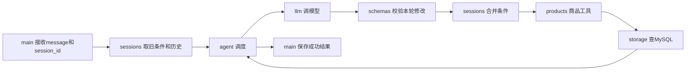

# 第三步：记住需求，只修改本轮指定的条件

> 本文保留第三步内存会话的学习过程；当前第四步已支持MySQL持久化，见[第四步B](04b-agent-persistent-context.md)。条件合并规则保持不变。

日期：2026-10-17（北京时间）。第二步已完成真实模型与 MySQL 工具调用。

本课只增加同一会话内的需求状态和最近对话，暂存在 Python 内存。服务重启后恢复属于第四步，本课不创建会话数据库表。

## 1. 先理解这次要解决的问题

第一次输入：找黑色0.5mm签字笔，单价不超过5元。

程序保存当前有效条件：

```json
{
  "category": "签字笔",
  "color": "黑色",
  "spec": "0.5mm",
  "max_price_fen": 500,
  "limit": 5
}
```

第二次输入：换得力，其他不变。

模型应生成本轮修改：

```json
{ "brand": "得力" }
```

Python 合并后的查询条件为：

```json
{
  "category": "签字笔",
  "brand": "得力",
  "color": "黑色",
  "spec": "0.5mm",
  "max_price_fen": 500,
  "limit": 5
}
```

重点：不要求模型每次完整复述所有旧条件。模型负责理解修改意图，Python 负责保留未修改字段并执行实际查询。

## 2. 模块怎么分、从哪里开始看

本项目采用平铺模块，暂不引入多层目录或框架；文件名直接反映职责。

| 模块            | 负责什么                                         | 不在这里做什么          |
| --------------- | ------------------------------------------------ | ----------------------- |
| app/main.py     | HTTP请求、取得会话、成功后保存本轮结果           | 不拼SQL、不解析模型协议 |
| app/schemas.py  | ChatRequest、SearchProductsArgs字段和校验        | 不发送请求              |
| app/sessions.py | 内存会话、旧条件与修改合并                       | 不查商品、不写数据库    |
| app/agent.py    | 串起模型→校验→合并→工具→回传的有界循环           | 不处理HTTP路由、不拼SQL |
| app/llm.py      | DeepSeek HTTP请求、响应消息和usage解析、接口错误 | 不更新会话、不查库      |
| app/prompts.py  | 集中保存SYSTEM模型指令                           | 不执行工具              |
| app/products.py | search_products工具契约和工具入口                | 不管理会话              |
| app/storage.py  | MySQL连接、参数化SELECT                          | 不理解自然语言          |
| app/config.py   | 读取本地配置与公共错误类型                       | 不打印密钥              |

第二步中的 SearchProductsArgs 已移到 schemas.py，connect 和 SQL 已移到 storage.py，HTTP请求与响应解析已移到 llm.py，提示词已移到 prompts.py。旧教程描述的是第二步当时的文件位置，现在以本节为准。seed_products.py 已更新为从 storage 导入 connect。docs/Q.md 保留给你自己的问题笔记，没有修改。

建议阅读顺序：先看 sessions.py 的 merge_requirements，再看 main.py 的 chat，最后看 agent.py 调用它们的位置。llm/storage 的细节沿用第二步知识，可以稍后对照。



## 3. 本课最重要的几行：合并条件

app/sessions.py 中：

```python
changes = patch.model_dump(exclude_unset=True)
merged = dict(current)
merged.update(changes)
return SearchProductsArgs.model_validate(merged)
```

- patch 是模型参数经过 Pydantic 校验后的对象。
- exclude_unset=True 只取本次实际传入的字段。SearchProductsArgs 中很多字段默认是None，但默认值不代表用户要求取消旧条件。
- dict(current) 复制旧条件，避免处理中途失败污染已保存的状态。
- update 类似 JavaScript 的对象合并：const next = {...current, ...changes}。
- 最后对完整合并结果再校验一次，然后才用于SQL查询。

### 不传字段与传null，有不同含义

| 本轮参数               | 含义                 |
| ---------------------- | -------------------- |
| {"brand":"得力"}       | 改品牌，保留其他条件 |
| {}                     | 没有条件修改         |
| {"brand":null}         | 明确取消品牌限制     |
| {"max_price_fen":null} | 明确取消预算上限     |

这里不能用 exclude_none=True 来提取本轮修改，否则“明确取消”的null会被删掉。保存完整条件和返回响应时才省略None字段；变化记录changes保留null。

### 换品类如何处理

category 明确变更时，Python 先清除旧 keyword、brand、color、spec，再应用本轮提供的新字段。预算和limit保留，用户也可以明确取消或修改它们。

例如从签字笔改为橡皮，旧的0.5mm不再适用；如果同时说“白色橡皮”，新的color=白色仍会保留。这里是本课明确采用的规则，不代表所有业务都应如此处理品牌；以后可按业务调整。

### 合并条件详解：从同一份旧条件看六个案例

补充日期：2026-10-17。本节仅解释现有代码，没有新增Agent能力。

#### 先认清三个变量

| 名字    | 是什么                                   | 前端类比               |
| ------- | ---------------------------------------- | ---------------------- |
| current | 上一轮保存的完整有效条件，Python字典     | 当前state              |
| patch   | 模型本轮给出的修改，已经转为Pydantic对象 | 一份经过校验的局部更新 |
| merged  | 复制旧条件后，应用修改得到的新条件字典   | nextState              |

这里的“合并”发生在Python内存中，不是合并数据库表、拼接聊天字符串，也不会修改商品记录。合并结果随后才作为SELECT的筛选条件。

以下六个案例都独立地从这份current开始，不是连续六轮：

```python
current = {
    "category": "签字笔",
    "brand": "晨光",
    "color": "黑色",
    "spec": "0.5mm",
    "max_price_fen": 500,
    "limit": 3,
}
```

这表示：晨光、黑色、0.5mm签字笔，单价最多5元，最多取3款。

#### 案例一：换得力，其他不变

模型本轮参数：

```json
{ "brand": "得力" }
```

agent.py先执行：

```python
patch = SearchProductsArgs.model_validate_json('{"brand":"得力"}')
args = merge_requirements(current, patch)
```

进入merge_requirements后：

```python
changes = patch.model_dump(exclude_unset=True)
# changes == {"brand": "得力"}

merged = dict(current)
# 复制current中的全部旧条件。

merged.update(changes)
# 只把同名brand改成得力；其他键保留。

return SearchProductsArgs.model_validate(merged)
# 校验新条件，返回SearchProductsArgs对象。
```

这个例子没有修改品类，因此中间清理品类条件的if分支不执行。

最终有效条件：

```json
{
  "category": "签字笔",
  "brand": "得力",
  "color": "黑色",
  "spec": "0.5mm",
  "max_price_fen": 500,
  "limit": 3
}
```

update按字段名覆盖，不是把两份字典的值拼接起来。新增的键会添加，已有的键会替换，未出现在changes中的键不动。

在不涉及品类清理的例子里，可以类比JavaScript：

```javascript
const changes = { brand: "得力" };
const merged = { ...current, ...changes };
```

#### 案例二：改蓝色，预算降到3元，其他不变

本轮修改：

```json
{ "color": "蓝色", "max_price_fen": 300 }
```

合并结果：

```json
{
  "category": "签字笔",
  "brand": "晨光",
  "color": "蓝色",
  "spec": "0.5mm",
  "max_price_fen": 300,
  "limit": 3
}
```

修改两个字段，其余保留，包括品牌晨光和最多3条。SQL会同时要求蓝色和price_fen<=300；合并函数本身不执行SQL。

#### 案例三：不限品牌，其他不变

本轮修改：

```json
{ "brand": null }
```

JSON的null解析到Python后是None：

```python
changes = {"brand": None}
merged.update(changes)
# merged里仍有brand这个键，但值已经变成None。
```

返回的args.brand是None。storage.py只有字段不为None时才加SQL条件：

```python
value = getattr(args, column)
if value is not None:
    clauses.append(f"{column} = %s")
    values.append(value)
```

所以这次SQL没有brand条件，并非查询“brand IS NULL”的商品。其他颜色、规格、品类和预算照常过滤。

agent.py随后使用args.model_dump(exclude_none=True)保存有效条件，因此响应中的current_requirements省略brand：

```json
{
  "category": "签字笔",
  "color": "黑色",
  "spec": "0.5mm",
  "max_price_fen": 500,
  "limit": 3
}
```

“不限价格”同理，只需传max_price_fen=null。注意：limit不允许null，因为程序始终需要限制返回条数。

#### 案例四：改找白色橡皮

本轮修改：

```json
{ "category": "橡皮", "color": "白色" }
```

此时执行现有代码中间的品类判断：

```python
if changes.get("category") is not None and changes["category"] != current.get("category"):
    for name in ("keyword", "brand", "color", "spec"):
        merged.pop(name, None)
```

拆开看：

1. changes.get("category")得到橡皮，不是None，说明本轮明确指定了品类。
2. 橡皮 != 签字笔，说明品类确实发生变化。
3. pop(name, None)删除旧的商品专属条件；没有该键时返回None，不报错。

清理之后、update之前，merged是：

```json
{ "category": "签字笔", "max_price_fen": 500, "limit": 3 }
```

这里category短暂还是旧值，但这只是函数内部的中间状态，尚未拿去查询。接着执行merged.update(changes)，得到：

```json
{ "category": "橡皮", "color": "白色", "max_price_fen": 500, "limit": 3 }
```

最终清掉旧的晨光、黑色和0.5mm，保留本轮明确提出的白色；预算仍是5元，最多3条。

为什么先清理再update？如果顺序反过来，新传入的白色也会被清理掉。当前规则是换品类时清掉旧brand/keyword/color/spec；本轮明确传入的新值随后重新添加。若模型把不该保留的旧值也传回来，程序仍会应用它，因此还要对照changes检查模型是否理解正确。

如果本轮category仍然是签字笔，则不清理这些旧条件。若明确传category=null，则仅取消品类过滤，不触发“换成另一品类”的清理规则。

#### 案例五：没有传任何修改参数

本轮修改是{}，changes也为{}。update空字典不会改变merged，所以旧条件原样保留。

这里说明的是函数规则；自然语言中需求不明确时，模型应先追问，不是所有模糊输入都应该生成空参数查询。

#### 案例六：明确改为最多5条

本轮修改：

```json
{ "limit": 5 }
```

虽然5恰好是字段默认值，但它是本轮明确传入的，exclude_unset=True仍会保留它。因此原limit=3改为5。

反过来，案例一只传brand时，Pydantic对象内部也有默认limit=5，但它没被本轮传入，exclude_unset=True会去掉它，原limit=3得以保留。

#### 为什么一定要exclude_unset？

比较这三种导出方式，下面只列出关键字段：

```python
patch = SearchProductsArgs(brand="得力")

patch.model_dump()
# 包含brand="得力"，还有默认color=None、spec=None、limit=5等。

patch.model_dump(exclude_unset=True)
# 只有{"brand": "得力"}。

patch.model_dump(exclude_none=True)
# {"brand": "得力", "limit": 5}，仍包含默认limit。
```

如果拿完整model_dump去update，默认None会清掉旧条件，默认limit=5也会覆盖旧limit=3。exclude_none虽然保住了其他非空旧条件，却会误改limit，也会丢掉明确用于取消的None。

关键是区分“有没有传这个字段”，而不只是“字段值是不是None”。

| 本轮输入         | exclude_unset结果         | 合并含义                      |
| ---------------- | ------------------------- | ----------------------------- |
| {}               | {}                        | 保留所有旧条件                |
| {"brand":"得力"} | {"brand":"得力"}          | 修改品牌                      |
| {"brand":null}   | Python中的{"brand": None} | 取消品牌                      |
| {"limit":5}      | {"limit":5}               | 明确改成5条，即使它等于默认值 |

#### 为什么复制旧字典，最后还要校验？

merged=dict(current)得到独立字典。若写成merged=current，两个变量指向同一份字典，update会立刻改坏已保存状态。当前字段都是字符串、整数或None，浅复制足够；以后加入嵌套列表/字典时要重新考虑复制策略。

最后model_validate检查完整条件类型和范围，返回可供args.brand访问的对象。它不查数据库，也不保存会话。agent用这个对象查询成功、生成回答后，main才保存新的会话条件；中途失败则仍保留原current。

### 离线练习：直接运行合并函数，看六组结果

下面代码可在项目Python环境中运行。不请求DeepSeek、不连接MySQL；patch手动构造，专门观察合并行为。expected是预期结果，assert检查真实函数输出是否一致。

<!-- merge-demo:start -->

```python
from app.schemas import SearchProductsArgs
from app.sessions import merge_requirements

current = {
    "category": "签字笔", "brand": "晨光", "color": "黑色",
    "spec": "0.5mm", "max_price_fen": 500, "limit": 3,
}
cases = [
    ("只改品牌", {"brand": "得力"}, {**current, "brand": "得力"}),
    ("改颜色和预算", {"color": "蓝色", "max_price_fen": 300},
     {**current, "color": "蓝色", "max_price_fen": 300}),
    ("取消品牌", {"brand": None},
     {key: value for key, value in current.items() if key != "brand"}),
    ("改白色橡皮", {"category": "橡皮", "color": "白色"},
     {"category": "橡皮", "color": "白色", "max_price_fen": 500, "limit": 3}),
    ("无修改", {}, dict(current)),
    ("明确改为5条", {"limit": 5}, {**current, "limit": 5}),
]

original = dict(current)
for label, changes, expected in cases:
    patch = SearchProductsArgs.model_validate(changes)
    args = merge_requirements(current, patch)
    actual = args.model_dump(exclude_none=True)
    assert actual == expected, label
    assert current == original, "原始条件不应被修改"
    print(label, "=>", actual)
```

<!-- merge-demo:end -->

以上字典推导式只是用于构造预期结果；刚开始可以先关注changes和actual。六个案例均使用原始current，便于对比；真实聊天会在成功后保存actual，作为下一轮current。

本轮验证：直接提取并执行本文的这段离线代码，六组实际结果全部符合预期，每次原始current均保持不变。没有调用模型或数据库，没有新增运行报错。

## 4. 会话ID、历史和条件分别是什么

- session_id：服务端生成的32位ID，帮助找到同一次对话；不是登录账号。本课为本机学习服务，没有用户鉴权，不面向公网部署。
- history：最近6轮用户文本和最终回答，帮助模型理解“那个”“其他不变”。不重放不完整的tool消息。
- requirements：单独保存当前有效筛选条件；即使老对话被截断，它仍然保留。

会话在SessionStore字典中；每个Session有自己的requirements和history，default_factory确保不同会话不共享可变对象。同一会话有锁，避免并发更新互相覆盖。模型或数据库失败时，不保存本轮修改；新的失败会话会被移除。

保存发生在run_agent完整返回后。商品查询返回0条也是成功查询，因此条件仍会保存；接口错误不是无商品。

内存会话上限100个；需要清空时重启服务。仅运行单个Uvicorn工作进程，多个进程不共享这些字典。--reload发生代码重载也会清空会话，旧ID返回404。

## 5. 你怎么启动和测试

```powershell
cd D:\myStudy\面试\search_goods
.\.venv\Scripts\python.exe -m uvicorn app.main:app --reload --host 127.0.0.1 --port 8000
```

如果8000上还是第二步旧服务，在运行它的终端Ctrl+C停止后再启动。GET /health 应显示step=3；不需要重新初始化商品表。

打开 http://127.0.0.1:8000/docs，POST /chat 首轮不传session_id（也可以传null）：

```json
{ "message": "找黑色0.5mm签字笔，单价不超过5元" }
```

从响应复制真实session_id。第二轮必须带回同一个ID，把下面占位文字替换为刚才的真实ID：

```json
{ "message": "换得力，其他不变", "session_id": "此处替换为首轮返回的32位ID" }
```

观察三个字段：

- tool_trace[0].changes：模型本轮提出的修改，期望只有brand=得力。
- current_requirements：Python保存的完整有效条件，颜色/规格/预算仍在。
- tool_trace[0].arguments：真正送给商品查询工具的完整条件。

接着可用同一个ID尝试“不限价格了，其他不变”和“改找橡皮，旧品牌、颜色和笔尖规格不保留”。不传ID则开始新会话。

## 6. 验证结果

```powershell
# 不访问模型/数据库的行为测试
.\.venv\Scripts\python.exe -m unittest discover -s tests -v
# 真实验收：访问MySQL与官方模型，产生API费用
.\.venv\Scripts\python.exe verify_step3.py
```

2026-10-17：11项单元测试通过，包含原第二步4项和第三步7项；依赖检查通过。覆盖未修改条件与limit保留、null取消、换品类清理、同品类不误清、真实执行前合并、会话隔离、失败不保存与未知会话404。第三步实现期间没有遇到运行报错。

真实验收脚本退出码0，五次/chat均实际访问MySQL和DeepSeek，每次内部请求模型2次：

| 场景                           | 查询结果                         | 本次总Token | 耗时   |
| ------------------------------ | -------------------------------- | ----------- | ------ |
| 黑色0.5mm签字笔，预算5元       | 3款                              | 2803        | 3.28秒 |
| 换得力，其他不变               | 1款，DEMO-PEN-0000，1.50元       | 2954        | 3.46秒 |
| 新会话找晨光蓝色0.7mm，预算4元 | 1款，DEMO-PEN-1110，2.50元       | 2583        | 3.66秒 |
| 回原会话取消预算               | 2款得力黑色0.5mm，1.50元与5.50元 | 3347        | 3.85秒 |
| 原会话切换橡皮                 | 清除旧品类条件，4款              | 3916        | 3.82秒 |

模型第二轮实际changes只有brand=得力，程序保留category/color/spec/max_price_fen/limit；独立会话插入后原会话仍保持得力条件。取消预算实际返回max_price_fen=null；切换橡皮最终有效条件仅category=橡皮、limit=5。

最后补充提示词要求使用纯文本/列表、不输出表格，并在真实Uvicorn服务上再次验证核心两轮：/health返回step=3，/docs返回200；第一次/chat返回3款（输入2465、输出282、总2747 Token，3.52秒），第二次带同一个ID“换得力，其他不变”返回1款（输入2708、输出129、总2837 Token，2.11秒）。changes仍只有brand=得力，完整条件准确保留，回答使用文本列表。未知会话ID返回404。当前本机服务已启动，可以直接访问/docs；启动命令仍保留供之后自行运行。

这验证了本次样例，不保证任意自然语言都正确。模型仍可能误解修改范围或主动填入不该修改的字段；Pydantic检查类型和范围，无法自动证明语义正确，所以返回changes与current_requirements供学习核对。

## 7. 本步先掌握三件事

1. 同一个session_id找到同一份state。
2. 模型给patch，Python按明确规则合并state，再查SQL。
3. 对话历史帮助理解，结构化条件负责准确保留。

第四步才把会话写到MySQL，让服务重启后可以继续。本步没有迁移或持久化聊天数据。

参考：[Pydantic exclude_unset](https://docs.pydantic.dev/latest/concepts/serialization/)、[FastAPI 进程与内存](https://fastapi.tiangolo.com/deployment/concepts/)。
