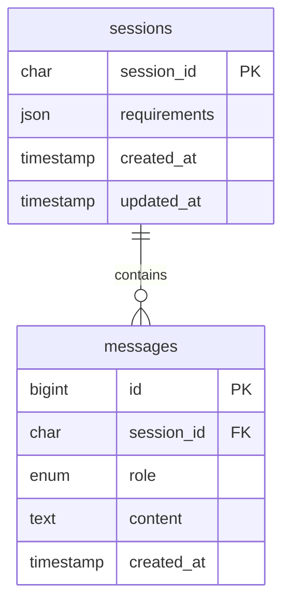

# 第四步A：会话表读写 + 简单聊天页

> 本文记录第四步A当时状态。第四步B已接入/chat持久化，并支持刷新恢复最近对话，当前运行方式见[第四步B](04b-agent-persistent-context.md)。

日期：2026-10-17（北京时间）。这是第四步的第一个小步骤。

## 本次做到了哪里

- 在现有练习库建立sessions、messages两张表，验证保存与读取。
- 加一个本地聊天页，继续调用原来的POST /chat，并自动携带session_id。
- /chat仍使用第三步内存会话；数据库读写模块还没有接入它。网页聊天暂不跨后端重启保存。

下一小步骤才把/chat改成从数据库恢复、在成功后保存。本次先学清楚表与读写函数。

## 1. 先用聊天页体验

在项目根目录启动；原服务已在运行时，先在它的终端Ctrl+C停止，再重新启动加载页面路由：

```powershell
.\.venv\Scripts\python.exe -m uvicorn app.main:app --reload --host 127.0.0.1 --port 8000
```

访问 http://127.0.0.1:8000/ ，先问“找黑色0.5mm签字笔，单价不超过5元”，再问“换得力，其他不变”。页面自动将首轮响应中的session_id带入下一轮，不需要手动复制。

Enter发送、Shift+Enter换行；中文输入法选字时Enter不触发发送。示例按钮只填入问题，不自动请求。发送期间禁用重复发送与新对话；点击“新对话”清空本页消息并开始新的服务端会话。它不会删除历史数据库记录。

页面按纯文本显示模型回复，不执行HTML，也不解析Markdown。请求失败时恢复输入；服务重启导致旧ID404时，提示开始新对话，不悄悄丢失旧条件继续查询。没有流式、图片、报价单或前端框架。

刷新页面会清空本页显示与会话ID（只保存在JS内存），服务端旧内存会话可能暂时还在。每次发送仍会调用真实DeepSeek，产生API费用。Key和数据库密码只由后端从本地配置读取，浏览器不接触它们。

## 2. 两张表怎么关联



| 表 | 存什么 | 示例 |
| --- | --- | --- |
| sessions | 一次对话的当前条件 | 黑色、0.5mm、预算500分 |
| messages | 用户说过的话与助手最终回答 | 用户“换得力”，助手“找到一款……” |

sessions.session_id是主键，一个ID对应一行会话。messages.session_id是外键，同一个ID可以对应多行消息。一轮对话写两条：user和assistant；id自增用于稳定排序，即使两条消息时间相同也能区分先后。

requirements使用MySQL JSON字段保存Python字典的JSON形式。Python先json.dumps转成JSON字符串交给驱动，读取后json.loads还原为字典，再进行Pydantic校验。JSON格式合法不代表业务条件正确，所以仍要业务校验。

本阶段只存文字对话与需求条件，不存Key、数据库密码或工具完整执行轨迹。后续若要回放每次tool_calls，应另行设计，不能把当前两种role当作完整Agent协议日志。

## 3. 文件各自负责什么

| 文件 | 职责 |
| --- | --- |
| sql/04-session-tables.sql | 两条建表SQL，可在Navicat阅读 |
| init_session_tables.py | 手动调用建表函数，不随API启动执行 |
| app/session_repository.py | 创建会话、保存一轮、读取会话 |
| verify_session_storage.py | 实际MySQL读写、跨进程读取和回滚验收，不调用模型 |
| web/index.html | 页面结构 |
| web/style.css | 页面样式及窄屏布局 |
| web/chat.js | fetch发送、保存session_id、展示消息与错误恢复 |
| app/main.py | 新增GET /返回页面，/assets只提供web目录资源 |

repository可以理解为专门处理会话表的数据库模块，继续复用storage.connect，不把所有SQL塞进main或agent。

## 4. 按执行顺序阅读存储函数

### initialize_tables：准备表

```powershell
.\.venv\Scripts\python.exe init_session_tables.py
```

只执行项目内固定SQL，创建缺失表；已有表不删除、不覆盖，也不自动迁移已有表结构。MySQL建表属于DDL，不要把两张表的创建理解成可以随意rollback的普通消息写入事务。若建到一半失败，已经建立的表可能仍在，修复后可以重新运行。

### create_session：建立一条空会话

生成32位ID，INSERT一行requirements={}，commit后返回ID。它创建的是MySQL记录，与第三步SessionStore内存里的Session暂时互不关联。

### save_round：保存一轮的完整结果

调用示例：

```python
save_round(
    session_id,
    {"category":"签字笔", "brand":"得力", "color":"黑色", "limit":5},
    "换得力，其他不变",
    "练习回复：已记录新的条件。",
)
```

requirements必须是合并后的完整条件，不是只有brand的patch。save_round保存状态，不负责合并；合并仍由sessions.merge_requirements完成。

执行过程：

1. 校验ID、条件及两段非空文本，失败则不写库。
2. 连接MySQL，用SELECT ... FOR UPDATE找到并锁住会话行。
3. UPDATE当前有效条件。
4. INSERT用户消息和助手消息。
5. 全部成功才commit；中途失败则rollback。

事务的用途是避免“条件已改、但只写了半轮消息”。模型请求应在调用save_round前完成，不能等着模型回答时一直持有这条连接或数据库行锁。

本步骤的存储函数还不负责多进程请求的版本冲突判断或请求重试去重；下一步接入本机单进程会话流程时继续保留同会话串行处理。

### load_session：从MySQL重建数据

按ID读取完整需求条件与最近12条消息（即最近6轮），返回：

```python
{
    "session_id": "32位真实ID",
    "requirements": {"category":"签字笔", "brand":"得力", "limit":5},
    "history": [
        {"role":"user", "content":"换得力，其他不变"},
        {"role":"assistant", "content":"练习回复：已记录新的条件。"},
    ],
}
```

SQL先倒序取最新12条，再用reversed恢复从旧到新的聊天顺序。所有消息都保存在数据库，只是读给模型的上下文限制为最近6轮。无此ID返回None；数据库错误抛AppError，两者不同。

## 5. 实际验证与边界

```powershell
.\.venv\Scripts\python.exe init_session_tables.py
.\.venv\Scripts\python.exe verify_session_storage.py
```

2026-10-17实际执行成功：

- 两张表已创建，原商品数据没有修改。
- 创建两个独立练习会话；第一个保存两轮共4条消息，第二个保持空条件和空消息。
- conditions JSON与用户/助手消息顺序读回一致。
- 启动新的Python子进程读取同一ID，得到相同数据，证明没有依赖原进程内存。
- 在真实事务中更新条件、写入第一条消息后，人为模拟第二条写入失败；之后读回的条件与消息都保持原状，没有半轮写入。
- 验收脚本不请求DeepSeek；保留两条练习会话供Navicat查看。重复运行会创建新的练习会话，不重复使用旧ID。

前端验证：node --check通过；用轻量DOM模拟验证首轮请求、后续携带ID、404恢复输入、新对话清ID、示例填入和控件恢复；FastAPI TestClient验证页面、JS、CSS、/docs返回200，配置文件不能通过这些路由访问。原11项后端测试通过。

环境没有可用的浏览器自动化包，未做浏览器视觉/实际点击验收；DOM模拟不能验证真实布局和浏览器输入法表现，请在本地打开页面体验。本次没有新增运行报错；事务中的失败是主动构造的验证场景，已确认成功回滚。

### 本地启动排错补充：WinError 10013（2026-10-17）

用户启动带--reload的Uvicorn时遇到WinError 10013。检查发现127.0.0.1:8000已有本项目旧Uvicorn后台进程35468监听；直接socket.bind测试返回10048（地址已使用），8001/8080/18000可绑定，8000不在Windows的IPv4/IPv6保留端口范围。

确认旧进程命令属于search_goods、uvicorn app.main:app、--port 8000后，仅停止此前助手启动的该进程。再次socket.bind(127.0.0.1,8000)成功，检查无8000监听进程。探测socket已关闭，没有再留下后台服务。

当前终端Ctrl+C只停止该终端的运行任务，不能保证另一个终端或助手后台服务退出。此次无需管理员权限、修改防火墙或保留端口设置；也不能把所有10013都一概视为同一种原因。

端口释放后在自己的终端重新运行原启动命令，再打开页面即可。

## 6. 下一小步骤

把main/chat中“取内存会话、保存内存会话”接入session_repository，再测试后端停止重启后同ID续聊。这一步尚未完成，当前页面不能跨重启继续原会话。

参考：[MySQL JSON字段](https://dev.mysql.com/doc/refman/8.0/en/json.html)、[MySQL建表](https://dev.mysql.com/doc/refman/8.0/en/create-table.html)。
