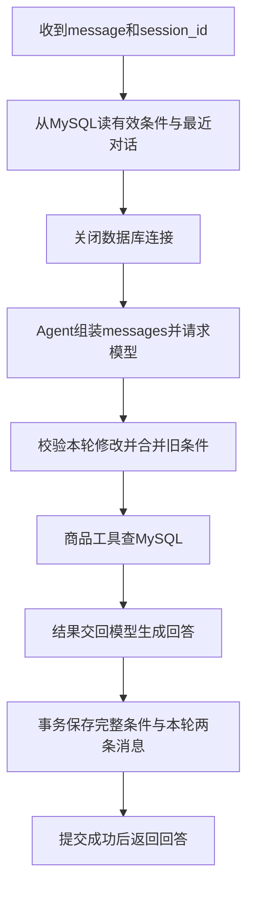

# 第四步B：Agent跨重启恢复上下文

日期：2026-10-17。本步已完成会话持久化接入，重点理解Agent的记忆如何装入一次请求。

2026-10-22补充：[第7节：为什么必须按照“加锁 → 恢复 → Agent → 保存”执行](#request-order-explained)，结合当前核心代码、并发时间线和数据变化阅读。

## 1. 先掌握这条链



session_id只是查找标识；模型不会凭这个ID自动记住历史。后台从数据库取回history和requirements，重新放进模型请求。即使Python进程重启，这两部分仍可恢复。

Agent不需要记住所有旧聊天才能保留条件：history只取最近6轮，requirements单独保存完整当前状态。工具使用合并后的条件重新查真实商品，不能只引用上一轮答案。

## 2. 关键代码从哪里看

| 文件 | 本次变化 |
| --- | --- |
| app/main.py | 同一会话加锁后reload；调用run_agent；成功后store.save |
| app/sessions.py | SessionStore可使用repository，运行时配置MySQL；reload恢复，save先落库再更新内存 |
| app/session_repository.py | 沿用第四步A的读写和事务；保存时不把未传默认值变成需求 |
| web/chat.js | sessionStorage只保存本标签页ID，刷新调用GET /sessions/{id}恢复最近消息 |
| verify_step4.py | 每轮使用全新Python进程运行FastAPI接口，检验不能依赖内存续聊 |
| tests/test_step4.py | 读上下文、保存顺序、失败不发布新状态、历史读取不调用模型 |

main中的关键顺序：

```python
with session.lock:
    store.reload(session_id, session)
    result = run_agent(
        body.message,
        current_requirements=session.requirements,
        history=session.history,
    )
    store.save(session_id, session, result, body.message)
```

- reload必须在拿到同会话锁后执行，避免两个请求同时使用旧条件。
- reload返回前已关闭数据库连接；锁只是Python线程锁，不是贯穿模型请求的数据库行锁。
- run_agent内的工具循环继续沿用第三步，不需要换Agent框架。
- save用事务同时保存有效条件、user消息和assistant最终回答；数据库保存失败返回503，不把未保存的结果当成功返回。
- 未找到会话返回404，数据库读取错误返回503；不伪装成新的空上下文。

这些顺序的原因和具体例子见下方[第7节](#request-order-explained)。

SessionStore()不传repository时仍是单元测试的内存实现；正式store显式传入session_repository。这个选择只是便于离线测试，不会自动在数据库失败时回退到内存。

## 3. 为什么持久化属于Agent能力

本步让Agent记忆有明确生命周期：请求开始恢复、执行中形成新状态、成功后保存。失败不产生半轮历史，也不覆盖上一轮有效状态。

例如：第一轮黑色0.5mm、预算5元保存到数据库；后端进程退出；新进程收到同ID“换得力”，先恢复旧状态，再应用brand=得力。模型拿到必要上下文，工具拿到完整查询条件。

这是会话记忆，不是RAG知识库。本步仍未引入Embedding、向量数据库或长期记忆检索。

## 4. 本地怎么验证

已有会话表不用重复建表。若环境里还没有表，先运行：

```powershell
.\.venv\Scripts\python.exe init_session_tables.py
```

在自己的终端重启后端，再刷新页面加载新JS：

```powershell
.\.venv\Scripts\python.exe -m uvicorn app.main:app --reload --host 127.0.0.1 --port 8000
```

打开 http://127.0.0.1:8000/ ：

1. 发送“找黑色0.5mm签字笔，单价不超过5元”。
2. 停止并重新启动后端（不要点新对话）。
3. 在同一标签页发送“换得力，其他不变”。应继续保留颜色、规格、预算。
4. 刷新页面，应恢复最近对话。刷新读取历史不调用DeepSeek，不增加模型费用。

第四步以前的纯内存会话不在数据库中，不能追溯恢复，第一次使用新版本时建议点击新对话。新对话只切换ID，不删除数据库记录。

浏览器只在sessionStorage中存ID，MySQL存消息与状态。关闭标签页后不能保证浏览器仍保留ID；此时仍可在/docs用已知ID继续，不等于数据库数据丢失。暂未提供会话列表。浏览器禁止sessionStorage时当前页面可聊天，但刷新不能自动找回ID。

## 5. 真实验证结果

2026-10-17：15项单元测试、JS语法及依赖检查通过。verify_step4.py的每次/chat都运行在独立的新Python进程中，实际使用MySQL和官方DeepSeek接口；上一进程已经退出，进程内会话与锁不能共享。

| 场景 | 结果 | 模型次数 | 总Token | 耗时 |
| --- | --- | --- | --- | --- |
| 首轮黑色0.5mm签字笔，预算5元 | 3款，落库2条消息 | 2 | 2733 | 2.42秒 |
| 新进程同ID“换得力” | 1款1.50元；其他条件保留；累计4条消息 | 2 | 2832 | 2.13秒 |
| 第三进程新会话找晨光蓝色0.7mm，预算4元 | 1款2.50元；未改变原会话 | 2 | 2537 | 2.04秒 |

原会话落库条件与Agent最终current_requirements一致，消息顺序为user/assistant/user/assistant。历史GET端点以新建练习会话做了真实数据库读取，返回200与两条历史；非法ID返回422。页面与/health正常，step=4。

前端用DOM模拟验证：首轮保存ID，刷新恢复历史，续聊携带ID，新对话清除ID，读取503保留ID便于重试，404清除无效ID；均通过。尚未做真实浏览器视觉自动化，不把DOM测试当成实际点击验证。

一次附加读取测试误用第四步A旧样例ID，当前库中不存在该记录，实际返回404导致预期200的断言失败。改为本次创建并保存的新会话后验证通过；没有据此猜测旧数据为何不在库中。

## 6. 本课边界与下一步

本机单工作进程；同会话锁只保护该进程内请求，暂不支持多个worker并发编辑同一会话。活跃会话上限100，重启可释放锁缓存，已存数据不丢。第一轮模型失败可能留下空会话行，不会写入伪造消息。请求没有幂等键，网络断开后盲目重试可能重复写入；这些留到后续错误恢复。

下一步回到Agent执行可靠性：无商品时如何回答、非法工具参数如何处理、接口超时与连续工具调用如何停止，以及用小样例评测。不会先增加更多界面功能。

<a id="request-order-explained"></a>

## 7. 补充：这一轮为什么必须按这个顺序执行

本节根据2026-10-22的代码补充。前面的第四课记录保留当时结果；项目后续课程增加了其他工具，但这里的会话读写顺序仍适用。

先抓住一个问题：**这一轮回答要基于上轮已经保存的状态；这一轮保存成功后，下一轮才能把它当成已有记忆。** 因此，需要保护的不是单独一条SQL，而是“读取旧状态 → 根据用户消息形成新状态 → 保存新状态”的完整过程。

### 7.1 先分清三个对象：数据库记录、session、result

假设上轮已经保存了“晨光、黑色、0.5mm、5元以内”。为方便阅读，下例只展示相关字段，金额单位是分。

```python
# MySQL中sessions.requirements这个JSON字段的内容
{
    "brand": "晨光",
    "color": "黑色",
    "spec": "0.5mm",
    "max_price_fen": 500,
}
```

| 对象 | 在哪里 | 作用 |
| --- | --- | --- |
| 数据库中的requirements和messages | MySQL两张表 | 跨进程重启保留的会话记录，是正式流程恢复上下文的依据 |
| `session.requirements`、`session.history` | Python进程内的`Session`对象 | 本次执行使用的条件与最近对话；`reload`会用数据库内容替换它们 |
| `result` | `run_agent`返回的Python字典 | 本轮计算得到的回答、新条件、诊断等；刚算出来时还没有完成会话保存 |

`session_id`负责找到同一个会话；模型收到的是后台组装的条件与历史，不是看到ID就自动恢复记忆。`requirements`保存当前有效条件，`history`保存最近文字消息，两者用途不同。

请求进来后还有一行前置代码：

```python
session_id, session = store.get_or_create(body.session_id)
```

它负责取得会话对象：新会话会创建数据库记录；旧会话不在本进程缓存中时，会先查库确认存在，再创建对应的内存对象。这次存在性检查不能代替后面锁内的`reload`：检查以后到真正轮到它执行之间，其他请求可能又保存了新状态。

### 7.2 `with session.lock`：先取得本轮执行权

`Session`的定义在[app/sessions.py](../app/sessions.py)：

```python
@dataclass
class Session:
    requirements: dict = field(default_factory=dict)
    history: list[dict] = field(default_factory=list)
    lock: Lock = field(default_factory=Lock)
```

`default_factory=Lock`表示每个新`Session`各自创建一把锁。在同一个Python进程里，相同`session_id`取得同一个`Session`对象，因此也使用同一把锁；不同会话有各自的锁。

```python
with session.lock:
    # 同会话的另一个请求必须等这整个缩进块执行结束。
    ...
```

可以把它理解成：先取得锁的请求完成这一整轮，后面的同会话请求再执行。正常走出缩进块会释放锁，执行过程中抛出异常并退出这个块也会释放锁。锁不会自动保存数据，也不会自动回滚SQL。这是Python锁与`with`各自提供的行为。[Python锁文档](https://docs.python.org/3.14/library/threading.html#lock-objects)、[with语句文档](https://docs.python.org/3.14/reference/compound_stmts.html#the-with-statement)。

源码另有`SessionStore._lock`，用于保护会话字典的查找、创建、移除。它与`session.lock`是两把不同的锁：前者管理“拿到哪个对象”，后者保护“这个对象的一整轮状态更新”。

### 7.3 `reload`：轮到我执行后，再读取最新的已保存状态

核心代码在[app/sessions.py](../app/sessions.py)：

```python
saved = self.repository.load_session(session_id)
if saved is None:
    raise KeyError(session_id)
session.requirements = saved["requirements"]
session.history = saved["history"]
```

这里有两层调用，要分开看：

1. `load_session`查数据库，返回包含`requirements`、`history`等字段的字典，找不到返回`None`。
2. `reload`把字典里的内容赋给传入的`session`对象；它本身返回`None`。所以主流程不写`session = store.reload(...)`。

恢复后的内存对象大致是：

```python
session.requirements == {
    "brand": "晨光", "color": "黑色",
    "spec": "0.5mm", "max_price_fen": 500,
}
session.history == [
    {"role": "user", "content": "找晨光黑色0.5mm签字笔，5元以内"},
    {"role": "assistant", "content": "……上一轮回答……"},
]
```

`reload`发生在锁内，是为了让“这一轮从哪份旧状态出发”也受保护。只锁住最后的保存，无法保证之前读取的状态仍然有效。

### 7.4 `run_agent`：用恢复的状态完成本轮计算

```python
result = run_agent(
    body.message,  # 本轮用户输入，例如：换得力，其他不变
    current_requirements=session.requirements,  # 刚恢复的完整条件
    history=session.history,  # 刚恢复的最近对话
)
```

你可以把这三个参数对应成前端函数调用：`runAgent(本轮输入, 当前筛选条件, 最近聊天记录)`。函数内部组装模型请求、执行工具、合并条件、取得回答。模型可能请求多次工具，因此一次`run_agent`不等于一次模型HTTP请求。

本例本轮只改品牌，但返回的是合并后的完整条件。以下为结构示意，省略了用量和诊断字段：

```python
result = {
    "answer": "……本轮得力商品回答……",
    "current_requirements": {
        "brand": "得力", "color": "黑色",
        "spec": "0.5mm", "max_price_fen": 500,
    },
}
```

注意两点：

- `result`是函数返回值，还没有因此写入会话表。Agent内部会复制条件，按本轮工具参数形成新状态；`store.save`才负责发布已保存的新记忆。
- 商品工具查MySQL，与会话的读写是不同调用。它可能在`run_agent`中打开自己的短连接查询商品，并在查询结束后关闭。知识检索也不等于在保存聊天记录。

### 7.5 `save`：先保存成功，再更新内存，最后才返回HTTP成功

核心代码在[app/sessions.py](../app/sessions.py)：

```python
self.repository.save_round(
    session_id, result["current_requirements"], question, result["answer"]
)
session.requirements = dict(result["current_requirements"])
session.history = [
    *session.history,
    {"role": "user", "content": question},
    {"role": "assistant", "content": result["answer"]},
][-12:]
```

这是普通的顺序执行：`save_round`没成功返回，就不会执行后面的内存赋值。这样不会出现“数据库仍是晨光，内存却已经宣布本轮保存成得力”的正常失败路径。

`[-12:]`只让内存保留最近12条消息，也就是这里约定的最近6轮；它没有删除数据库旧消息。下次`load_session`同样取最近12条，再恢复为时间正序。

`save_round`在[app/session_repository.py](../app/session_repository.py)中使用同一个数据库连接、同一个事务，完成三项写入：

| 写入 | 内容 | 为什么一起保存 |
| --- | --- | --- |
| 更新`sessions.requirements` | 本轮完整有效条件JSON | 之后续聊以新条件为准 |
| 插入`messages`一行 | 本轮user消息 | 记录用户改了什么 |
| 插入`messages`一行 | 本轮assistant最终回答 | 记录本轮实际完成的回答 |

```python
# 示意控制流；完整SQL见session_repository.py。
try:
    # SELECT ... FOR UPDATE，确认并锁定会话行。
    # UPDATE完整requirements。
    # INSERT本轮user和assistant两条消息。
    connection.commit()
except (pymysql.MySQLError, AppError):
    connection.rollback()
    raise
```

事务解决的是：若插入消息时发生可正常处理的SQL错误，之前的条件更新也一起撤销，避免只保存半轮。这里覆盖的是**完整条件JSON**，并非数据库自动把本轮品牌补丁与最新条件合并。

保存完成后退出`with session.lock`释放会话锁，然后`main.py`才执行成功返回：

```python
return {"session_id": session_id, **result}
```

因此，“模型生成了回答”与“这一轮已经完成并保存”是两个时刻。前端只有在后者成功后才应把它当作完成的一轮。

### 7.6 两个请求同时来，正确顺序会怎样

假设两个请求属于同一会话：A说“换得力，其他不变”，B说“预算改成3元，其他不变”。初始状态为“晨光，5元以内”，其余条件省略，假设A先取得锁。

| 时刻 | 请求A | 请求B | 数据库已提交的条件 |
| --- | --- | --- | --- |
| 1 | 拿到会话锁 | 尚未执行 | 晨光、500分 |
| 2 | `reload`恢复晨光、500分 | 到达，在会话锁外等待，不能执行锁内`reload` | 晨光、500分 |
| 3 | `run_agent`形成得力、500分 | 继续等待 | 晨光、500分 |
| 4 | `save`提交得力、500分，再更新内存 | 继续等待 | 得力、500分 |
| 5 | 退出锁 | 拿到锁，`reload`读取得力、500分 | 得力、500分 |
| 6 | 本轮已完成 | `run_agent`形成得力、300分，再保存 | 得力、300分 |

**B要保留的是A刚刚保存的品牌，所以必须在A保存结束后再读。** Python锁不保证多个等待者严格按照HTTP到达顺序获得锁；本例只是假设A先取得锁。锁也不保证A的HTTP响应一定先抵达浏览器。

### 7.7 如果把`reload`搬到锁外，为什么仍然可能出错

下面的写法不安全，即使`run_agent`和`save`仍在锁里：

```python
# 错误示例，不要这样修改。
store.reload(session_id, session)
with session.lock:
    result = run_agent(...)
    store.save(...)
```

一个直观问题是：等待执行前取得的快照，可能已经过期。结合本项目“同一进程共享同一个`session`对象”的实现，可以具体出现下面这种交错：

| 时刻 | 发生了什么 |
| --- | --- |
| 1 | A完成锁外恢复，取得锁，开始基于晨光、500分运行Agent。 |
| 2 | B在锁外调用`reload`；其中`load_session`读到旧值晨光、500分并返回。线程恰好在把`saved`赋给`session`之前暂停。 |
| 3 | A完成计算，保存得力、500分，更新共享`session`为新值，释放锁。 |
| 4 | B继续执行刚才的赋值，把它之前读到的晨光、500分写回共享`session`。 |
| 5 | B取得锁，用晨光、500分处理“预算改成3元”，保存晨光、300分。A改的品牌被覆盖。 |

这不是每次都发生，而是并发时允许出现的一种执行顺序。`load_session`返回与后面的两条赋值并不是不可分割的一步；在线程之间，不能靠“应该执行得很快”保证安全。

因此，保护范围必须同时包含`reload`、`run_agent`、`save`。如果运行完Agent就提前释放锁、之后才保存，也会让后一个请求在旧数据上开始执行。

### 7.8 锁还拿着，为什么数据库连接已经关了

`with`只是管理资源的语法，具体退出时做什么，取决于它管理的对象：

| 写法 | 进入时做什么 | 退出时做什么 |
| --- | --- | --- |
| `with session.lock:` | 获取Python线程锁 | 释放这把锁 |
| `with connect() as connection:` | 取得这里新建的PyMySQL连接 | 当前安装的PyMySQL会调用`connection.close()` |
| `with connection.cursor() as cursor:` | 取得游标 | 关闭游标；这与关闭连接是两回事 |

`load_session`里确实把`return`写在`with`内部：

```python
with connect() as connection:
    with connection.cursor() as cursor:
        # 两次SELECT，得到requirements和history。
        return {"session_id": session_id, "requirements": requirements, "history": history}
```

实际执行是：先准备返回字典 → 退出游标的`with` → 退出连接的`with`并关闭连接 → 调用方才取得字典。不是字典先交出去、连接以后再找机会关闭。字典和列表是已经读进Python内存的数据，关闭连接不会让它们消失。[Python with语句的退出规则](https://docs.python.org/3.14/reference/compound_stmts.html#the-with-statement)。

把两种资源画在同一条时间线上，就清楚了：

```text
同会话Python锁： [取得 ───────────────────────────────────────── 释放]
执行阶段：        reload         run_agent                  save
会话读取连接：    [打开/读取/关闭]
DeepSeek请求：                   [请求模型/等待/取得回答]
商品查询连接：                   可能在工具执行时[打开/查询/关闭]
会话保存连接：                                             [打开/事务/关闭]
```

这些是分别调用`connect()`取得的连接，不是读取会话时打开的连接一直用到回答结束。这样，等待模型的几秒钟里不需要一直占用会话读写连接及其数据库行锁。

再明确数据库锁的细节：当前`load_session`第一条SELECT也有`FOR UPDATE`，后面再读消息；`save_round`同样先锁对应会话行。配合使用这些方法的读写能在短事务内协调，避免读条件和读消息之间插入一次会话保存。但读取函数退出关闭连接后，该只读事务结束、锁释放；它没有自动提交写入，也没有继续保护模型计算阶段。InnoDB锁定读的锁由事务边界控制。[MySQL锁定读说明](https://dev.mysql.com/doc/refman/8.4/en/innodb-locking-reads.html)。

这解释了为什么同时需要两者：Python锁保护本进程中一整轮的先后顺序；数据库事务保证这次条件与两条消息一起提交。**仅在保存时加数据库行锁，也无法修复先前已经基于过期条件算好的完整JSON。**

### 7.9 任意一步失败，后面还会执行吗

`raise`会中断当前正常执行路径，向外寻找异常处理；它不像返回一个普通错误字典后还能接着往下运行。

| 失败位置 | 当前行为 | 为什么这样处理 |
| --- | --- | --- |
| 找到格式合法的ID，但对应会话不存在 | 返回404，不执行这一轮Agent | 确认没有这条记录，不能假装有旧记忆 |
| 恢复会话时数据库故障 | 返回503，不执行这一轮Agent | 读取失败不等于会话不存在，更不能拿空条件回答“其他不变” |
| Agent发生已处理的业务/模型错误 | 返回503，不调用正常的本轮保存 | 没有完整成功结果，不写入一轮成功历史 |
| 正常可处理的SQL写入失败 | 尝试回滚，返回503；不更新内存为本轮新条件 | 避免半轮数据及虚假的保存成功 |
| 保存成功 | 更新内存，退出锁，再返回成功结果 | 下一轮可以从已保存状态继续 |

这里的404、503是HTTP状态码；代码中间可能先抛`KeyError`或`AppError`，由`main.py`转换成对应HTTP响应。客户端请求格式本身不合法则还可能在进入这段代码前得到422。

不要把事务范围理解得过大：回滚会话写入不能撤销已经消耗的模型Token。另有一个当前实现的边界：如果数据库已经提交，但提交确认时网络断开，应用可能得到失败，却无法仅凭503确定数据库完全没写入；HTTP成功响应丢失也有类似问题。因此当前流程不提供重试“恰好执行一次”的保证，不能盲目重复提交。本节的事务说明针对可确认的正常提交与可正常处理的回滚路径。

### 7.10 阅读源码时，按照这五个问题追踪

1. **谁控制执行权？** `main.py`的`with session.lock`，覆盖这一整轮。
2. **旧记忆从哪里来？** `sessions.reload → session_repository.load_session → MySQL → session`。
3. **新记忆怎么形成？** `run_agent`读取已恢复的上下文，通过工具循环返回`result`。
4. **什么时候算保存成功？** `sessions.save → session_repository.save_round → commit`成功返回，然后更新内存。
5. **什么时候告诉前端成功？** 上述步骤结束，退出会话锁之后。

适用范围仍是本机单工作进程。同一进程的锁不能协调多个worker或多台服务器；数据库短事务也没有把整轮模型计算变成跨进程串行。多进程场景需要另外设计版本校验、冲突处理或其他协调机制。

相关补课：[会话锁与不加锁示例](grammer/07-session-locks.md)。本次补充只解释现有实现，不修改业务逻辑；验证结果见下一小节。

### 7.11 本次说明怎样核对的（2026-10-22）

运行现有的第四课离线测试：

```powershell
.\.venv\Scripts\python.exe -m unittest discover -s tests -p test_step4.py -v
```

4项通过，覆盖恢复后再调用Agent、保存失败不发布新内存状态、模型失败不保存、历史接口不调用模型及缺失记录404。这些测试替换了数据库和模型依赖，不代表本轮重新做了真实MySQL或DeepSeek验收。

另外，用真实的`SessionStore.reload/save`配合内存中的模拟repository、两个线程及事件控制，复现了上面两种顺序；没有调用真实模型或数据库。输出中的`old`代表晨光，`new`代表得力：

```text
reload在锁内：A读old → A保存new → B读new → B保存new
最终条件：brand=new，max_price_fen=300

reload在锁外：A读old → B读old → A保存new → B保存old
最终条件：brand=old，max_price_fen=300
```

第二个演示是有意安排的错误交错，用来验证风险，不表示现有锁内实现发生了故障。同时核对了当前安装的PyMySQL源码：连接的`__exit__`调用`close()`，连接参数`autocommit`默认`False`，项目`connect()`没有覆盖该默认值。
