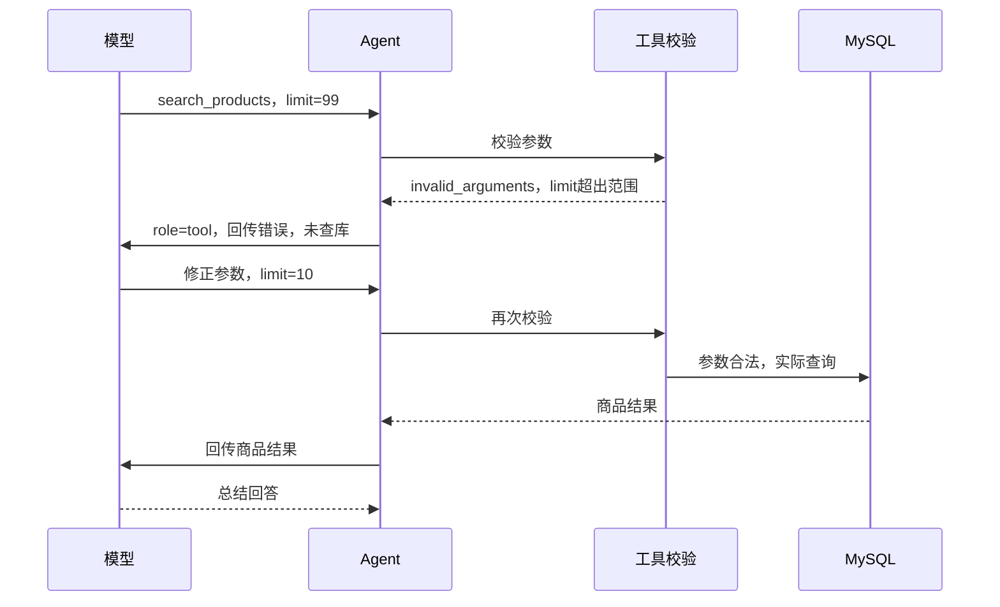

# 第五步：Agent错误恢复、执行边界与小评测

日期：2026-10-17。本步完成V1的有界执行与基础评测，重点在Agent如何根据工具反馈采取下一步。

## 1. 错误不是一种情况

| 情况 | 系统处理 | 模型是否继续 |
| --- | --- | --- |
| 参数正确，SQL结果为空 | 工具返回no_results | 总结没有商品，不擅自放宽条件 |
| 模型生成的参数不合法 | 返回invalid_arguments及字段/错误类型，尚未查SQL | 在预算内修正参数或追问 |
| 数据库不可用 | tool_failed，停止本轮 | 不把错误说成没有商品 |
| 模型超时/网络失败/HTTP错误 | 停止，返回503与安全诊断 | 不自动重试 |
| 未授权工具 | unknown_tool，拒绝执行 | 停止 |
| 超过请求/工具次数 | execution_limit，停止 | 不允许无限循环 |
| 输出被截断 | output_truncated，停止 | 不使用半条工具参数或半段回答 |

最关键的学习点：可恢复错误作为工具结果进入messages，成为模型下一次决策的依据。数据库故障和未知工具不能靠让模型不断试来解决。

## 2. 参数修正是怎样发生的



新增app/tool_runner.py负责校验、合并、执行查询和记录工具耗时；agent.py仍负责循环、请求次数、结果回传与最终回答。

错误工具结果示意：

```json
{
  "status":"invalid_arguments",
  "issues":[{"field":"limit","type":"less_than_equal"}],
  "message":"参数未通过校验，尚未查询数据库。请按工具契约修正……"
}
```

故意不附products=[]，否则容易与成功查询但没有商品混淆。也不回传原始参数、异常全文和输入值，只提供字段及校验类型。

非法参数不查询数据库、不更新requirements，但也消耗一次工具调用额度。模型修正时必须保留用户的品牌、规格和预算；如果业务需求本身无法按工具契约表达，就追问，不能偷偷修改。

如果模型没有修正成功就给出“找到了”，程序不会直接相信：最后一个工具状态仍为invalid_arguments时，固定返回“参数尚未校验通过，请明确需求”，outcome=needs_clarification。

## 3. 哪些地方限制它继续运行

配置值读取自环境变量，未配置时使用默认值；模板.env.example已列出字段。无需修改Key配置。

| 配置 | 默认 | 限制 |
| --- | --- | --- |
| AGENT_MAX_MODEL_CALLS | 3 | 一轮/chat最多请求模型3次，允许配置2—5 |
| AGENT_MAX_TOOL_CALLS | 3 | 一轮/chat工具请求总数，允许配置1—10；非法请求也计数 |
| DEEPSEEK_TIMEOUT_SECONDS | 60 | HTTP网络操作超时，允许配置1—120秒 |
| DEEPSEEK_MAX_TOKENS | 700 | 每次输出上限，允许配置128—2000 |

每轮模型返回的工具请求还不能超过3个。最后一次模型请求设置tool_choice=none，只能总结或追问；如果模型仍返回工具调用，Python继续拒绝，不能只靠提示词约束。

这些是次数和网络操作边界，不是精确费用上限，也不是整轮严格墙钟截止时间。网络失败不自动重试；真实请求是否已被服务端处理不能单凭本地超时判断。

## 4. 从返回数据观察Agent

正常响应保留answer、current_requirements、tool_trace、usage，并增加：

- outcome：answered、no_results、needs_clarification或reply。
- recovered：是否经历非法参数反馈后又成功查询。
- model_trace：每次模型请求的用量、状态和耗时。
- tool_trace[].status / elapsed_seconds：每个工具步骤状态和耗时。
- usage_complete：本次统计是否包含所有模型步骤已知用量。

超时等失败时返回HTTP503：

```json
{
  "detail":"模型请求超时，本次已停止，未自动重试。",
  "error_code":"model_timeout",
  "diagnostics":{
    "usage":{"prompt_tokens":0,"completion_tokens":0,"total_tokens":0},
    "usage_complete":false,
    "model_trace":[],
    "tool_trace":[],
    "elapsed_seconds":0
  }
}
```

这里仅为结构示意，真实诊断会包含失败步骤及实际耗时。usage_complete=false时，usage只是已知部分，不表示服务端一定没有消耗Token。如果前一次请求成功、下一次超时，仍保留前一次的用量。输出截断时接口已报告的usage也保留。

模型或数据库失败不保存成功对话。保存会话失败返回session_save_failed，并保留本轮已知用量便于核对；不会声称已保存。参数未修正最终追问、或查到0条，属于正常业务结果，可以保存。

聊天页继续简洁展示回答；观察完整诊断时在/docs或浏览器Network看/chat响应。不额外建设日志平台。

## 5. 怎样运行评测

```powershell
# 全部离线行为测试，不调用模型和数据库
.\.venv\Scripts\python.exe -m unittest discover -s tests -v
# 真实MySQL+DeepSeek样例及可控故障注入，产生API费用
.\.venv\Scripts\python.exe verify_step5.py
```

完整报告：outputs/05-agent-evaluation.json。报告只记录练习问题、回答、条件、工具轨迹、用量和耗时，不记录Authorization或原始错误正文。已按本地凭据做了不回显值的排除检查。

本次真实结果：

| 场景 | 状态 | 步骤数 | 总Token | 耗时 |
| --- | --- | --- | --- | --- |
| 得力黑色0.5mm，预算5元 | answered，1款 | 2次真实模型请求 | 2702 | 2.73秒 |
| 同条件预算0.01元 | no_results，0款 | 2次真实模型请求 | 2610 | 2.79秒 |
| 注入limit=99后修正 | recovered=true，1款 | 1次注入+2次真实模型请求 | 2434 | 2.70秒 |

修正样例的第一条模型消息是人为注入，不是实际模型自然犯错；该步用量记为0并标注mode。之后模型看到真实校验反馈，修正limit为10，通过校验并实际查询，再总结。保留了得力、黑色、0.5mm和预算500分。报告model_calls=3表示循环步骤，real_model_requests=2才是该场景实际远程次数。

26项离线测试全部通过，包含原15项及新增11项：错误反馈后修正、修不正不得虚构成功、无商品、数据库故障、工具总额度、连续工具调用、超时不重试、截断用量、后续超时保留已有用量、HTTP原始错误不泄露、畸形tool_calls拒绝。超时和数据库故障是注入测试，不伪装为本轮发生的线上事故。

这些是本次样例验收，不是任意自然语言正确率，也未完成大规模评测、并发多worker、请求幂等、断线去重或自动回退模型。

## 6. 本轮配置排错

发现.env.example被填入实际格式Key，读取模板时该值进入了工具输出。已清空模板Key和密码字段，没有修改.env.dev；提醒用户在官方控制台轮换这个Key。本记录和报告不复制Key或其片段。今后配置文件只检查字段名/是否为空，不直接输出全文。

本轮功能实现与测试没有运行错误；错误修正、超时及事务等失败场景为主动测试。没有启动新的后台Uvicorn占用8000，用户原服务可通过reload加载变化或手动重启。

## 7. V1到这里有什么

真实模型调用、固定商品工具、参数校验与SQL、结构化需求合并、多轮状态、会话持久化、错误反馈、执行上限、基础评测都已具备。

下一阶段再选一个Agent能力练习，例如增加第二个只读工具观察工具选择，或按原计划进入小型知识检索。暂不自动引入RAG、向量数据库和复杂框架。
