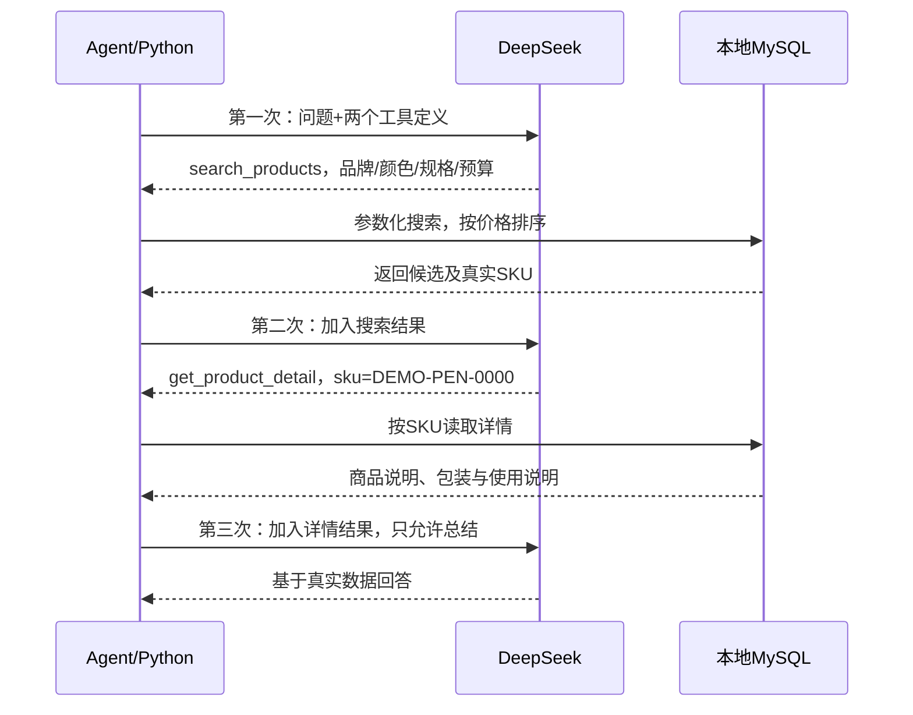

# 第六步：Agent如何选择并串联多个工具

> 本文保留第六课的两个商品工具示例。第七课增加知识工具，并在app/tools.py统一汇总，见[最小RAG](07-minimal-rag.md)。

日期：2026-10-17。本课只增加一个只读工具get_product_detail，不引入RAG或Agent框架。

## 1. 本步学什么

以前只有search_products，模型只需要决定是否搜索。现在有两个工具：

| 工具 | 适用问题 | 输入 | 是否修改搜索条件 |
| --- | --- | --- | --- |
| search_products | 找得力黑色0.5mm笔，预算5元 | 本轮筛选条件修改 | 合并并更新条件 |
| get_product_detail | 查看SKU的说明、包装信息 | 一个明确SKU | 不修改条件 |

用户没有给SKU却要求详情时，模型需要先搜索得到真实SKU，再查详情；直接给SKU时可以跳过搜索。两个工具的选择仍由模型通过tool_calls给出，Python负责校验、分发和执行。

## 2. 三个名字对应三个阶段

```text
tools       给模型看的“可用能力说明”
tool_calls  模型返回的“想调用什么及其参数”
handlers    Python中“工具名对应哪个执行函数”
```

### tools：模型看得到契约，看不到执行代码

app/products.py定义TOOLS=[TOOL, DETAIL_TOOL]。agent发送：

```python
payload = {
    "model": model,
    "messages": messages,
    "tools": TOOLS,
    "tool_choice": "auto",  # 最后一轮仍为none
}
```

每个工具包含名称、用途和参数JSON Schema。新增GetProductDetailArgs只有必填sku字段，严格类型、长度及字符规则，拒绝额外字段。描述和prompts告诉模型：筛候选用搜索，查说明用详情；没有明确SKU先搜索，不能猜。

### tool_calls：模型本次做了什么选择

模型可能返回：

```json
{
  "id":"call_detail_demo",
  "type":"function",
  "function":{
    "name":"get_product_detail",
    "arguments":"{\"sku\":\"DEMO-PEN-0000\"}"
  }
}
```

arguments仍是JSON字符串。模型没有登录本地MySQL，也没有直接调用Python。

### handlers：程序按固定映射分发

agent.py中两个小包装函数分别调用execute_search与execute_detail，并组成映射：

```python
handlers = {
    "search_products": run_search,
    "get_product_detail": run_detail,
}

if function["name"] not in handlers:
    raise AppError("模型请求了未授权工具，本次已停止。", code="unknown_tool")

result, requirements, tool_record = handlers[function["name"]](
    function["arguments"], requirements
)
```

字典中存的是函数，查询工具名后调用对应函数。模型给任意其他名称都会拒绝，没有eval或任意SQL执行。

工具返回后仍按第五步的方式添加role=tool消息，下一次模型请求看到实际结果，再决定继续调用还是回答。不需要为不同工具写新的Agent循环。

## 3. 一个完整的三次请求过程

用户问：先找最便宜的得力黑色0.5mm签字笔，单价不超过5元，再看详细说明、包装和使用说明。



这个顺序由模型在本次样例中自主选择，程序没有用“用户包含包装两字”之类关键词if硬编码流程。提示词是指导，不是正确性证明，因此继续用tool_trace观察和评测。

默认最多3次模型请求，足够“搜索→详情→总结”。如果中途还要纠正参数，剩余步数可能不够；系统仍按边界停止或说明缺失，不会无限增加请求。明确SKU直接查详情通常只需要2次请求。

## 4. 详情来自哪里，为什么与搜索不同

新增product_details表，以sku关联products。仅准备3条明确标为练习数据的纯文本说明：得力笔DEMO-PEN-0000、晨光笔DEMO-PEN-1000、橡皮DEMO-ERASER-0。

```powershell
.\.venv\Scripts\python.exe seed_product_details.py
```

已经在本机执行成功。再次执行新增0条，不覆盖已有说明，不改商品价格、库存或其他字段。初次环境须先有products练习表。

storage.find_product_detail使用参数化WHERE p.sku=%s和LEFT JOIN：

- 商品不存在：返回None，工具status=not_found。
- 商品存在、详情未提供：返回商品，description/package_notes/usage_notes为None；模型应说明未知，不能编造。
- 说明存在：按真实说明回答。例子里只知道按支销售，没有盒装数量，因此不能猜一盒几支。

详情按SKU精确查询，不套用当前品牌/预算过滤，也不只返回有库存商品；有库存的候选筛选仍由搜索工具处理。比如原需求是得力，用户单独查看晨光SKU，可以如实查看，但原需求仍是得力。

execute_detail返回新复制的current，保证详情查询不修改搜索条件；get_product_detail也不能绕过参数校验、只读SQL和第五步的总工具额度。

## 5. 哪些文件有变化

| 文件 | 职责 |
| --- | --- |
| app/schemas.py | 新增GetProductDetailArgs |
| app/products.py | 第二个工具契约、TOOLS列表、详情入口 |
| app/storage.py | 参数化按SKU查详情 |
| app/tool_runner.py | execute_detail：校验、查询、not_found与耗时 |
| app/agent.py | 固定handlers分发；错误记录正确工具名 |
| app/prompts.py | 选择工具与先后依赖、未知详情规则 |
| seed_product_details.py | 建详情表，插入缺失的练习说明 |
| tests/test_step6.py | 两工具分发、详情不改需求、参数/缺失/错误路径 |
| verify_step6.py | 全真实API+MySQL工具选择验收 |

建议先看agent.py的handlers，再看products.py两个工具的description，最后看tool_runner.py的execute_detail。

## 6. 怎么体验和验证

重载或重启自己的后端，打开 http://127.0.0.1:8000/ ：

1. “先找最便宜的得力黑色0.5mm签字笔，单价不超过5元，再查询它的详细说明、包装信息和使用说明。”
2. “只查看SKU DEMO-PEN-1000的说明和包装信息，不修改刚才的筛选条件。”
3. “查询SKU DEMO-NOT-EXIST-999的详细说明，不存在就告诉我。”

要观察选择过程，在/docs或Network看tool_trace[].tool。第一条需求期望search_products→get_product_detail，第二条只调用详情，并保留current_requirements。

```powershell
.\.venv\Scripts\python.exe -m unittest discover -s tests -v
# 真实模型与数据库验收，会产生API费用
.\.venv\Scripts\python.exe verify_step6.py
```

本轮结果（2026-10-17）：31项测试及依赖检查通过，详情脚本首次新增3条，再运行新增0条。以下四组全部真实调用官方模型和本地MySQL，没有故障注入：

| 场景 | 实际工具顺序 | 模型次数 | 总Token | 耗时 |
| --- | --- | --- | --- | --- |
| 找最便宜候选并查看详情 | search_products→get_product_detail | 3 | 4678 | 4.20秒 |
| 同会话明确晨光SKU，原需求仍得力 | get_product_detail | 2 | 3871 | 2.86秒 |
| 不存在的SKU | get_product_detail，not_found | 2 | 3056 | 2.37秒 |
| 商品存在、说明未提供 | get_product_detail，明确说明未知 | 2 | 3253 | 2.64秒 |

第一组实际返回DEMO-PEN-0000、单价1.50元，并引用包装说明“未提供盒装数量”；第二组查看晨光但保留得力/黑色/0.5mm/预算500分的原条件；缺失说明案例SKU为DEMO-PEN-0001。

报告：outputs/06-tool-selection-evaluation.json，含真实回答、状态、工具轨迹、条件、用量与耗时。已检查没有本地凭据，未记录请求头或原始错误。

本轮没有运行报错。用户询问是否卡住时说明正在划分工具边界，随后补充实现和验证进度；没有把规划阶段说成已写好代码。没有启动后台服务占用用户8000端口，也没有修改.env.dev或前端界面。

## 7. 本课的Agent知识点

工具选择取决于用户目标、工具描述、参数契约和当前观察；模型决定调用意图，程序只执行固定的合法能力。有前后依赖的调用必须把前一个真实结果交回模型，再让它决定下一步。

本次样例通过不等于所有模糊指代都正确。若“那个商品”无法唯一定位，应追问；不提供盒装信息时应承认未知。下一阶段再进入知识检索，继续区分商品SQL与规则知识的来源。
