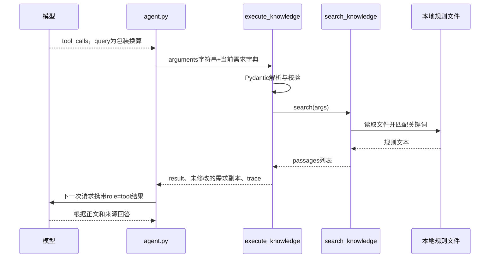

# 第07课补充：为什么把RAG检索做成工具，以及execute_knowledge逐段讲解

日期：2026-10-18。对应问题：为什么知识检索放进tools？execute_knowledge每一段何时执行、数据怎样变化？

第八课更新提示：execute_knowledge的参数校验与三元组流程继续适用；search_knowledge内部现改为检索片段索引。运行本文演示前先执行build_knowledge_index.py，结果会多出chunk_id、行号和版本。详见[第八课](08-knowledge-chunks-and-index.md)。

这篇只解释并验证现有实现，不修改业务代码，不调用DeepSeek或MySQL。

## 1. 为什么知识检索出现在tools中

先分清三个位置：

| 位置 | 保存什么 |
| --- | --- |
| knowledge/KB-*.md | 真正的规则正文，例如盒与支不能统一换算 |
| app/knowledge.py | 读取文件和关键词匹配的Python实现 |
| app/tools.py | 模型可调用的能力说明清单，里面没有完整知识正文 |

我们把“查知识”封装成一个模型可以请求的能力，名字叫search_knowledge。模型看到工具名称、用途和参数格式，知道自己可以向程序索取资料。

例如用户问：

> 为什么不能把所有签字笔默认一盒12支？

模型先提出调用search_knowledge，程序查到规则，再把正文返回模型。模型在第二次请求时才有这份资料可用。

普通“找得力黑色笔，预算5元”则可以只调用search_products，不必每次都读取规则。

### RAG常见的两种接法

| 接法 | 执行顺序 | 谁决定是否检索 |
| --- | --- | --- |
| 固定检索流程 | 用户问题→程序检索→模型回答 | 程序按固定流程执行 |
| 本项目的工具方式 | 用户问题→模型选择检索工具→程序检索→模型回答 | 模型根据任务和工具描述提出选择 |

因此，RAG并不要求一定使用tools。本项目选择第二种，是为了学习Agent怎样选择能力，同时复用已有的参数校验、调用上限、工具结果回传和trace。

这个设计也带来一个需要评测的点：模型可能选错工具或没有检索，所以提示词、工具说明和测试都要同步维护，不能只在文件夹放几份规则就以为它会自动使用。

## 2. 先看这个函数在调用链中的位置



execute_knowledge既不向DeepSeek发HTTP请求，也不生成最终自然语言回答。它处在中间，负责“验参数→调用检索→包装结果”。

## 3. 函数签名逐个看

```python
def execute_knowledge(
    arguments: str,
    current: dict,
    *,
    search=search_knowledge,
) -> tuple[dict, dict, dict]:
```

### arguments：模型给出的JSON字符串

调用示例：

```python
arguments = '{"query":"包装 换算","limit":1}'
```

外面是单引号，说明Python中的arguments是字符串；字符串里面才是一份JSON。它还不是可以直接args.query访问的参数对象。

### current：当前有效商品条件

```python
current = {"brand":"得力", "color":"黑色", "max_price_fen":500}
```

这个字典已经由外层会话流程提供。传进来是为了保持所有工具执行函数的接口一致：都接收当前需求，并返回下一份需求。知识检索只读资料，本轮需求内容原样保留。

### 单独的星号*：后面的参数必须按名字传

合法调用：

```python
execute_knowledge(arguments, current, search=some_search_function)
```

不能把第三个函数直接当位置参数传入：

```python
# 会因为参数传法不对而报TypeError，不会进入函数体。
execute_knowledge(arguments, current, some_search_function)
```

这里的*是函数形参的分隔符，不是乘法，也不是后面**result那种字典展开。

### search=search_knowledge：函数可以作为参数

没有括号的search_knowledge是函数对象；search=search_knowledge只是指定默认函数，不会立刻读取文件。

例如：

```python
def demo_search(args):
    return []

execute_knowledge(arguments, current, search=demo_search)
```

进入函数后，search这个名字指向demo_search；执行search(args)时，真正被调用的就是demo_search。

默认情况下它指向实际的search_knowledge。agent.py也显式传入search=search_knowledge，测试时可以换成返回固定结果或模拟失败的函数。这个做法通常叫依赖注入；先理解成“把要调用的函数交进来”即可。

结合前端经验，大致类似：

```javascript
function executeKnowledge(argumentsText, current, {search = searchKnowledge} = {}) {
  // 后面需要检索时再调用search(args)。
}
```

注意Python的默认参数在定义函数时绑定，后面才是实际调用；本项目这条参数用于方便控制执行与测试。

### tuple[dict, dict, dict]：返回三份字典

调用方这样接收：

```python
result, requirements, tool_record = execute_knowledge(arguments, current)
```

| 返回位置 | 函数内名字 | 给谁使用 |
| --- | --- | --- |
| 第一个 | result | 给模型看的工具结果 |
| 第二个 | dict(current) | Agent继续使用的需求条件，内容不变 |
| 第三个 | trace | 记录执行过程，最终出现在tool_trace中 |

这是Python返回值类型标注，不会自动校验运行时返回值。真正的校验在下面的Pydantic代码里。

## 4. 开始计时：perf_counter

```python
started = perf_counter()
```

started记录一个适合测量时间间隔的计时值。后面：

```python
round(perf_counter() - started, 3)
```

表示“现在减开始时刻”，单位秒，保留3位小数。它统计这次工具包装、校验和检索的耗时，不是整轮聊天耗时，也不是北京时间日期。

## 5. 解析和校验arguments

```python
try:
    args = SearchKnowledgeArgs.model_validate_json(arguments)
except ValidationError as exc:
    ...
```

这一步先解析JSON，再按SearchKnowledgeArgs校验：

- query必须是字符串，去首尾空白后长度1—200。
- limit必须是整数，范围1—3，不传时默认3。
- 不允许file、sql等额外字段。

输入：

```python
arguments = '{"query":"包装 换算","limit":1}'
```

校验成功后：

```python
args.query  # "包装 换算"
args.limit  # 1
```

args是Pydantic对象。输入JSON字符串、校验后的对象、稍后返回的字典，是三种不同形式。

校验成功会跳过整个except，继续下面的search(args)；校验失败才进入except，并且会提前return。

## 6. 参数错误时，为什么要整理issues

以这个输入为例：

```python
arguments = '{"query":"包装","limit":99}'
```

limit最多3，99不合法，Pydantic抛ValidationError。

```python
issues = []
for issue in exc.errors(
    include_input=False,
    include_context=False,
    include_url=False,
):
    ...
```

exc.errors()把异常整理成“错误字典列表”，因为同一次输入可能有多个字段错误。for遍历列表，一次处理一条。

这三个开关控制错误字典包含哪些信息：

| 参数 | 不保留什么 |
| --- | --- |
| include_input=False | 触发错误的原始输入值 |
| include_context=False | ctx附加信息，例如校验上下文 |
| include_url=False | Pydantic错误说明网页链接 |

它们不会发起网络请求，只是控制异常输出。接下来代码还进一步只取field和type，不把完整异常转发给模型。

这个例子的错误条目包含类似信息（仅列出会用到的字段）：

```python
{"loc": ("limit",), "type": "less_than_equal"}
```

### loc是什么

```python
field = issue["loc"][0] if issue["loc"] else "arguments"
```

这是Python条件表达式：

```python
if issue["loc"]:
    field = issue["loc"][0]
else:
    field = "arguments"
```

loc表示错误的位置，一般是元组：

- ("limit",)：limit有问题，取第0项得到"limit"。
- ("query",)：query有问题，得到"query"。
- ()：没有可定位的字段，例如整个输入不是合法JSON，统一记为"arguments"。

先判断loc是否非空，再取[0]，避免空元组触发IndexError。

### 为什么还要判断model_fields

```python
issues.append({
    "field": field if field in SearchKnowledgeArgs.model_fields else "arguments",
    "type": issue["type"],
})
```

SearchKnowledgeArgs.model_fields是字段定义字典，当前包含query和limit。对字典使用in，是判断键名是否存在。

这段的意思是：只把已知字段名回传；模型额外传入的file等未知键名，统一显示arguments，不直接回显任意输入键名。

最终得到：

```python
issues = [{"field":"limit", "type":"less_than_equal"}]
```

append是往Python列表末尾添加一个元素。type是错误类别，帮助模型知道“超过上限”，不是Python的type()函数调用。

实际离线验证的四组结果：

| 输入问题 | field | type |
| --- | --- | --- |
| limit=99 | limit | less_than_equal |
| query只含空格 | query | string_too_short |
| 额外传file字段 | arguments | extra_forbidden |
| 整个输入为not-json | arguments | json_invalid |

## 7. 参数错误分支怎样返回

```python
result = {
    "status":"invalid_arguments",
    "issues":issues,
    "message":"规则检索参数无效，尚未检索；请提供非空query及1到3的limit。",
}
trace = {
    "tool":"search_knowledge",
    **result,
    "elapsed_seconds":round(perf_counter() - started, 3),
}
return result, dict(current), trace
```

result告诉模型这次工具没执行成功，需要修正参数。它不附passages=[]，避免混淆成“合法检索但没有相关资料”。

`**result`是字典展开，类似JavaScript的`...result`。trace里因此同时有tool、status、issues、message和elapsed_seconds。

dict(current)复制旧字典，内容不变，返回一个独立的字典对象。这是浅复制，本项目条件值主要是字符串、整数或None，符合当前用途；它不查数据库，也不保存会话。

return把这三份字典组成元组返回，并结束本次函数调用。后面的search(args)不会执行。外层Agent收到invalid_arguments后，按第五课的预算规则让模型修正或追问。

## 8. 参数正确后，真正检索的地方

```python
try:
    passages = search(args)
except AppError:
    raise AppError(
        "规则检索暂时不可用，本次未完成检索；这不表示没有相关规则。",
        code="tool_failed",
    ) from None
```

search(args)才真正调用检索函数。默认就是app/knowledge.py中的search_knowledge，它读取本地Markdown并按关键词命中数排序。

passages是列表：查到规则时包含若干字典，没匹配则是[]。这一行不查询MySQL，也不调用DeepSeek。

如果读取规则文件出错、文件缺失或格式损坏，检索函数抛AppError。这里转成对外统一的tool_failed，外层Agent停止本轮。

raise是抛异常，和上面return结果是两种不同路径。发生这个异常后，不会执行下方正常result构造，也不会返回三元组。

from None抑制默认异常展示中的原始异常链，避免直接把底层细节带出去；它不表示原异常从运行时彻底消失，也不是所有日志的统一脱敏开关。

本项目AppError的code是自定义错误分类，由config.py定义。它不是Python内置异常自带的字段。

## 9. 成功执行后，区分命中与无匹配

```python
result = {
    "status":"ok" if passages else "no_knowledge",
    "practice_data":True,
    "passages":passages,
}
```

Python中空列表[]是假值，非空列表是真值，因此：

- passages有元素：status为ok。
- passages=[]：status为no_knowledge。

注意与JavaScript不同，JavaScript的空数组[]是真值。

practice_data只是告诉模型这些是练习资料，不是控制流程的特殊语法。

接着：

```python
trace = {
    "tool":"search_knowledge",
    "arguments":args.model_dump(),
    **result,
    "elapsed_seconds":round(perf_counter() - started, 3),
}
return result, dict(current), trace
```

args.model_dump()把校验后的对象转成普通字典，记录实际使用的参数。不传limit时，里面会有默认limit=3；这里记录实际检索配置是合理的，它不是商品需求的patch合并。

这个函数到此结束。把result编码为JSON字符串写进role=tool，再请求模型，是外层agent.py做的事情。

## 10. 四个完整案例放在一起看

固定旧需求：

```python
current = {"brand":"得力", "color":"黑色", "max_price_fen":500}
```

| 案例 | 输入 | 执行到哪里 | 返回/抛出 |
| --- | --- | --- | --- |
| A：命中规则 | query=包装 换算、limit=1 | 校验→实际检索→包装 | result.status=ok，需求不变，trace有来源正文 |
| B：参数错误 | query=包装、limit=99 | 校验失败，提前return | invalid_arguments，未读取资料，需求不变 |
| C：无匹配 | query=保修政策 | 校验→检索成功但0条 | no_knowledge，passages=[]，需求不变 |
| D：资料故障 | 合法参数，但读取失败 | 校验→检索抛异常 | 抛AppError(code=tool_failed)，没有正常三元组 |

A与C是正常执行的两种业务结果；B让模型在预算内修正；D停止本轮，不能伪装成没有规则。

## 11. 可以直接运行的离线演示

在项目Python环境运行。只有A/C读取本地规则，B验证检索未被调用，D人为模拟故障；不会调用DeepSeek或数据库。

<!-- knowledge-wrapper-demo:start -->
```python
import json
from unittest.mock import Mock

from app.config import AppError
from app.tool_runner import execute_knowledge

current = {"brand":"得力", "color":"黑色", "max_price_fen":500}
original = dict(current)

# A：真实读取本地规则。
valid = json.dumps({"query":"包装 换算", "limit":1}, ensure_ascii=False)
result, after, trace = execute_knowledge(valid, current)
assert result["status"] == "ok"
assert result["passages"][0]["source_id"] == "KB-PACK-001"
assert after == current and after is not current
print("A 命中：", result["status"], result["passages"][0]["source_id"])

# B：参数错误时，search根本不会被调用。
fake_search = Mock()
result, after, trace = execute_knowledge(
    '{"query":"包装","limit":99}', current, search=fake_search,
)
assert result["status"] == "invalid_arguments"
assert result["issues"] == [{"field":"limit", "type":"less_than_equal"}]
fake_search.assert_not_called()
print("B 参数错误：", result["issues"])

# C：参数合法，但本地资料没有匹配的保修规则。
result, after, trace = execute_knowledge('{"query":"保修政策"}', current)
assert result["status"] == "no_knowledge" and result["passages"] == []
assert trace["arguments"]["limit"] == 3
print("C 无匹配：", result["status"])

# D：把检索函数换成一个主动抛异常的函数。
def failed_search(args):
    raise AppError("离线测试模拟文件读取失败")

try:
    execute_knowledge(valid, current, search=failed_search)
except AppError as exc:
    assert exc.code == "tool_failed"
    print("D 模拟故障：", exc.code)
else:
    raise AssertionError("应当抛出AppError")

assert current == original
print("原商品条件保持不变。")
```
<!-- knowledge-wrapper-demo:end -->

本轮已直接运行本文演示，四个案例全部通过。另验证了空query、额外file字段、非法JSON的错误类型，均未调用检索。D是主动构造的模拟故障，没有实际文件损坏或真实模型接口报错。

## 12. 最后看这一层与上下层的边界

```text
tools.py              告诉模型有这个能力
agent.py              接收tool_calls，找到执行器
execute_knowledge     校验与包装，把底层执行接入统一工具接口
search_knowledge      实际找资料
agent.py              把result交回模型，保存trace，继续下一轮
```

你可以先只记住execute_knowledge的顺序：校验→检索→包装。再用上面四种情况判断它会走哪条分支，暂时不用一次记住所有Python语法。

源码依据：[tool_runner.py](../app/tool_runner.py)、[knowledge.py](../app/knowledge.py)、[tools.py](../app/tools.py)、[schemas.py](../app/schemas.py)、[agent.py](../app/agent.py)。主课：[第07课最小RAG](07-minimal-rag.md)。
