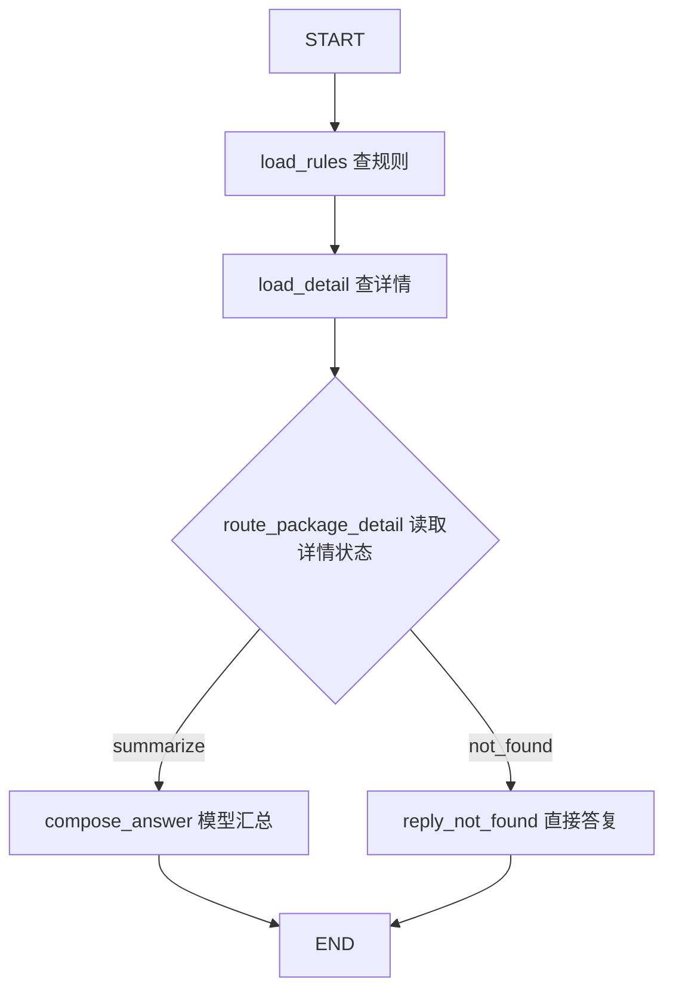

# 第十六课：用条件边选择下一步

日期：2026-10-27。开发分支：`feat/16-conditional-routing`，从已合入第15课的main建立；旧直线图可在`lesson-15`标签查看。

## 1. 本课解决什么问题

第15课的图永远执行三个节点：查规则、查详情、整理回答。SKU不存在时，虽然不会调用模型，但仍进入compose_answer，再在函数内部判断并返回。

本课把这个判断移到图的条件边，分开两个职责：找到商品时汇总证据，没有商品时直接答复。



菱形是路由函数，不是注册的业务节点。图里登记了4个业务节点，一次正常执行只经过其中3个。

本课没有增加模型判断。分支由Python根据已查到的事实决定，接口路径、请求体、工具顺序和业务结果继续沿用。

## 2. 在什么时候决定路线

```text
HTTP收到sku并校验
  → 创建本次State
  → load_rules取得规则结果
  → load_detail取得详情结果
  → 条件边调用route_package_detail，读取更新后的State
  → 只执行选中的一个后续节点
  → 返回原接口结果
```

路由发生在详情节点成功返回之后。详情读取抛异常时，图会停止，不会把数据库故障当成商品不存在。

本课仍先查规则再查详情；缺SKU时也执行了规则检索。改变的是后续控制流，不能宣称省掉了原有规则查询或原本就不存在的模型请求。

## 3. 修改哪些文件，为什么

| 文件 | 本课变化 |
| --- | --- |
| [workflows.py](../app/workflows.py) | 新增纯路由函数、独立未找到答复节点；移除汇总节点内的缺SKU答复 |
| [package_graph.py](../app/package_graph.py) | 将详情后的普通边替换为条件边，两条路径分别结束 |
| [main.py](../app/main.py) | 课次标识16，HTTP路径与输入保持不变 |
| [test_step16.py](../tests/test_step16.py) | 验证分支互斥、错误不能变成未找到、混合请求隔离 |
| test_step15.py / verify_step15.py | 继续验证旧业务契约，更新缺SKU路径的观察预期 |
| [verify_step16.py](../verify_step16.py) | 复用既有基线和真实检查，单独保存第16课报告 |

`workflow_state.py`不需要新字段。`detail`里本来就有status和product，路由直接读取。商品SQL、RAG、DeepSeek接口、证据校验和/chat会话逻辑都继续复用。

## 4. 同一个State，详情结果决定不同去向

初始状态仍由`new_package_state(sku)`创建。前两个节点执行完后，有以下两种正常观察。只列相关字段，包装文字为示意。

找到商品：

```python
{
    "sku": "DEMO-PEN-0000",
    "detail": {
        "status": "ok",
        "product": {"sku": "DEMO-PEN-0000", "package_notes": None},
    },
    "node_trace": ["load_rules", "load_detail"],
}
```

`product`是商品字典，所以商品存在。`package_notes=None`只表示缺少包装说明，仍应汇总并明确数量未知。

没有找到商品：

```python
{
    "sku": "DEMO-NOT-EXIST-999",
    "detail": {"status": "not_found", "product": None},
    "node_trace": ["load_rules", "load_detail"],
}
```

两者的关键区别是商品本身有没有查到，不能用包装说明是否为空判断商品是否存在。

## 5. 路由函数返回什么

`route_package_detail`的核心代码：

```python
def route_package_detail(state) -> Literal["summarize", "not_found"]:
    detail = state["detail"]
    if isinstance(detail, dict) and "product" in detail:
        product = detail["product"]
        if detail.get("status") == "ok" and isinstance(product, dict) and product.get("sku") == state["sku"]:
            return "summarize"
        if detail.get("status") == "not_found" and product is None:
            return "not_found"
    # 源码在这里构造workflow_state_invalid错误并附上已有诊断。
```

`Literal`描述允许的两个字符串，帮助阅读和类型检查；真正的业务约束仍由函数中的判断执行。

输入是State，输出是一个路线标签，既不是回答文本，也不是状态更新字典。这个函数不调用工具、不查库、不请求模型，也不修改State。

正常条件之外会停止：没有detail、状态与product矛盾、返回了另一SKU等，都是内部观察不可靠，不能用“商品不存在”掩盖。此时HTTP返回503，错误码为`workflow_state_invalid`。

路由读取的detail来自工具结果。前端仍只允许提交sku，不能通过请求体伪造图里的status。

## 6. 一个标签怎样选中节点

在`package_graph.py`中：

```python
builder.add_conditional_edges(
    "load_detail",
    route_package_detail,
    {"summarize": "compose_answer", "not_found": "reply_not_found"},
)
builder.add_edge("compose_answer", END)
builder.add_edge("reply_not_found", END)
```

按顺序理解这三个参数：

1. 从哪个节点之后开始判断：load_detail。
2. 用哪个Python函数判断：route_package_detail。
3. 函数返回的标签对应哪个节点：summarize对应compose_answer，not_found对应reply_not_found。

这里没有把两个后续节点都执行一遍。正常情况下，路由只返回一个标签，所以选择一条路径。[官方条件边说明](https://docs.langchain.com/oss/python/langgraph/graph-api#conditional-edges)。

原来的`add_edge("load_detail", "compose_answer")`已删除。若保留普通边又增加条件边，原普通路径也可能执行；仅“多写一条条件边”不能完成迁移。

## 7. 两个后续节点分别做什么

**compose_answer**：只处理找到商品的状态，继续收集规则和SKU证据，至多请求一次DeepSeek，校验引用、补充未知项，再填入answer、answer_details、usage等。

**reply_not_found**：检查自己确实收到not_found观察后，直接设置：

```python
current["answer"] = f"本轮未查到SKU {state['sku']}，无法核对该商品的包装信息。请确认SKU。"
current["outcome"] = "not_found"
```

直接答复不读取模型Key，不请求模型；初始usage保持0、model_trace保持空。两个节点都返回兼容的State，原`run_package_check`继续统一整理HTTP结果。

| 观察 | 后续节点 | outcome | 模型次数 |
| --- | --- | --- | --- |
| 有商品及包装说明 | compose_answer | answered | 至多1次 |
| 有商品，缺包装说明 | compose_answer，说明未知 | answered | 至多1次 |
| 明确未找到商品 | reply_not_found | not_found | 0次 |
| 数据库读取错误 | 停止，返回503 | 错误响应 | 0次 |
| 状态矛盾或SKU不匹配 | 路由处停止，返回503 | 错误响应 | 0次 |

## 8. 怎么从响应看出走了哪条路

存在的SKU：

```json
{
  "node_trace": ["load_rules", "load_detail", "compose_answer"],
  "outcome": "answered",
  "model_calls": 1
}
```

不存在的SKU：

```json
{
  "node_trace": ["load_rules", "load_detail", "reply_not_found"],
  "outcome": "not_found",
  "model_calls": 0
}
```

路由函数不是节点，因此node_trace中没有route_package_detail。这个列表记录实际进入的节点；异常时包含失败节点，不表示列表中每一步都成功。

工具轨迹仍都是search_knowledge、get_product_detail两条。`node_trace`描述图步骤，`tool_trace`描述业务工具；两种观察不要混淆。

## 9. 本地运行与验收

依赖沿用第15课，无需新增安装或重建索引。确认分支后启动原服务：

```powershell
git branch --show-current
.\.venv\Scripts\python.exe -m uvicorn app.main:app --reload --host 127.0.0.1 --port 8000
```

在`http://127.0.0.1:8000/docs`调用原`POST /workflows/package-check`，依次发送：

```json
{"sku": "DEMO-PEN-0000"}
```

再用DEMO-PEN-0001和DEMO-NOT-EXIST-999替换sku。前两个进入compose_answer，最后一个进入reply_not_found。调用模型会计费。

```powershell
# 全部行为测试，不访问真实模型或数据库。
.\.venv\Scripts\python.exe -m unittest discover -s tests -q
# 6个离线业务基线对照。
.\.venv\Scripts\python.exe verify_step16.py
# 再加真实MySQL、RAG、DeepSeek；API部分会计费。
.\.venv\Scripts\python.exe verify_step16.py --with-live
```

第16课复用verify_step15里的检查函数，不执行其main，也不覆盖第15课报告。业务结果仍与第14课原实现对照，开发起点则是lesson-15。只忽略耗时和图元数据，回答、错误、用量与工具观察保持一致。

新报告在本地`outputs/16-conditional-routing-evaluation.json`，按现有忽略规则不上传。重新运行离线模式会覆盖这份报告并将真实检查标为skipped。

## 10. 2026-10-27实际验证

114项行为测试、依赖检查及6个业务基线对照通过。新增8项测试覆盖纯路由、不完整或矛盾状态、两个节点互斥、缺包装说明、数据库错误不假装无商品、错误SKU停止、混合并发请求和直接答复节点的入口检查。

| 真实SKU | 最后节点 | 模型次数 | 总Token | 耗时 |
| --- | --- | --- | --- | --- |
| DEMO-PEN-0000 | compose_answer | 1 | 1902 | 5.07秒 |
| DEMO-PEN-0001 | compose_answer | 1 | 2007 | 3.24秒 |
| DEMO-NOT-EXIST-999 | reply_not_found | 0 | 0 | 0.62秒 |

三个案例使用真实本地RAG和MySQL，前两个请求官方DeepSeek；非法SKU仍返回422。固定流程不写聊天会话。模型调用次数与第15课相同，不能把这次Token和耗时差异解释为条件边带来的性能收益。

## 11. 读代码时只追这条线

`load_package_detail`写出detail → `route_package_detail`读status/product并返回标签 → package_graph里的字典映射选节点 → 被选节点更新answer → 原入口返回。

这是确定性的工作流分支；/chat里的Agent仍由模型选择工具。下一课再学习检查点，把执行状态持久化；本课没有提前加入暂停恢复、审批或多Agent。
