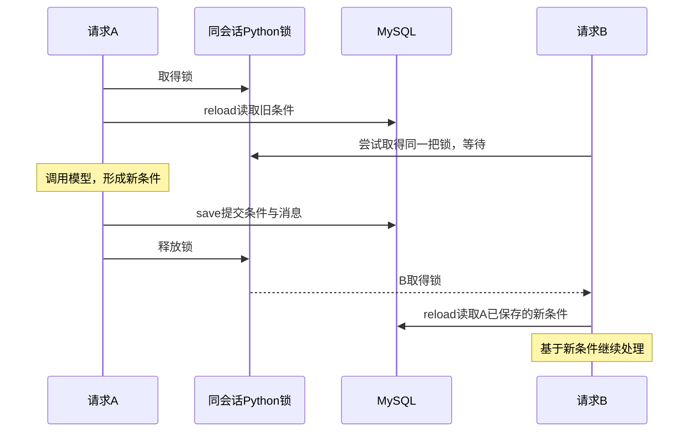

# 第四步B的锁：不加锁会怎么样？

对应文档：[第四步B：Agent跨重启恢复上下文](../04b-agent-persistent-context.md)。本文只解释当前代码，不修改业务实现。

**锁让使用同一把锁的请求轮流进入一段代码。这里最重要的是让同一会话的“读取 → 模型处理 → 保存”整轮依次执行，避免后一次保存覆盖另一个请求的修改。**

## 1. 先理解为什么会同时收到请求

一次模型请求可能需要几秒。这期间，另一个请求也可能到达后端：例如两个客户端带着同一个 session_id 调用 `/chat`。

当前 `/chat` 是同步函数，FastAPI 可以在线程池中处理多个请求。一个线程等待模型响应时，另一个线程可以继续读数据库。即使平时只在单个页面聊天，也不能把“不会重复点击”当成后端的并发保证。

这里“同时”包括交错执行，不要求两个线程在同一瞬间执行同一条 Python 指令。

## 2. 用第四步B的流程举例：不加会话锁

数据库中某个会话的初始条件是：

```python
{"category": "签字笔", "color": "黑色", "max_price_fen": 500}
```

两个请求带着**同一个 session_id** 到达：

- 请求 A：“换得力，其他不变。” → 本轮修改 `{"brand": "得力"}`。
- 请求 B：“预算改成3元，其他不变。” → 本轮修改 `{"max_price_fen": 300}`。

如果把 main.py 里的 `with session.lock:` 去掉，可能出现下面的执行顺序。为了看清问题，假设模型都正确理解了用户要求：

| 时刻 | 请求 A | 请求 B |
| --- | --- | --- |
| 1 | reload，读到黑色、预算500分、没有品牌 | |
| 2 | 用读到的旧条件请求模型，等待响应 | reload，也读到黑色、预算500分、没有品牌 |
| 3 | | 合并预算300分，形成“黑色、预算300分、没有品牌” |
| 4 | 合并品牌得力，形成“黑色、预算500分、得力” | |
| 5 | 保存“黑色、预算500分、得力” | |
| 6 | | 保存“黑色、预算300分、没有品牌” |

最终数据库条件是：

```python
{"category": "签字笔", "color": "黑色", "max_price_fen": 300}
```

**A 刚加上的得力品牌消失了。** B 没要求取消品牌，但它生成的完整条件来自尚无品牌的旧状态，最后保存时覆盖了 A 的状态。这叫“丢失更新”。

如果保存顺序反过来，也可能变成品牌保留，而 B 的预算300分被 A 的旧预算500分覆盖。

这里特意选择了“两个请求都先取得旧条件，再各自生成结果”的一种合法交错。没有锁时，内存中的 Session 属性也会被交错修改，因此并不是每次都出现完全相同的结果；关键是结果失去可靠保证。

## 3. 为什么不是两个人改不同字段就没关系？

模型传来的 patch 确实只包含本轮修改，但项目先把 patch 合并成完整条件，然后保存完整条件：

```python
# session_repository.py 中的保存形式，省略周边代码
cursor.execute(
    "UPDATE sessions SET requirements = %s WHERE session_id = %s",
    (encoded, session_id),
)
```

这个 UPDATE 替换整份 requirements JSON，不是在数据库里只改 brand 或预算。两个请求即使改不同字段，只要都从旧状态生成完整结果，后保存的一份就可能抹掉先保存的修改。

还可能出现：messages 表里两轮对话都成功写入，但最终 requirements 丢掉其中一轮修改。数据库事务可以保证每轮写入完整，却不会自动检查“计算结果是不是基于最新上下文”。

## 4. 加上会话锁后，第四步B怎么执行？

文档里的核心代码：

```python
with session.lock:
    store.reload(session_id, session)
    result = run_agent(
        body.message,
        current_requirements=session.requirements,
        history=session.history,
    )
    store.save(session_id, session, result, body.message)
```

假设 A 先拿到锁：

| 时刻 | 请求 A | 请求 B |
| --- | --- | --- |
| 1 | 拿到这个会话的锁 | |
| 2 | reload → 模型处理 → 保存得力品牌 | 到达同一把锁处，等待，尚未执行 reload |
| 3 | 退出 with，释放锁 | |
| 4 | | 拿到锁，reload 读到已经包含得力的新条件 |
| 5 | | 在新条件上改预算为300分，保存并释放锁 |

最终结果：

```python
{"category": "签字笔", "color": "黑色", "brand": "得力", "max_price_fen": 300}
```

B 的 history 也会包含 A 刚保存的消息，模型拿到的上下文更完整。

锁不保证请求一定按点击顺序或到达顺序取得锁。如果 B 先取得锁，则 A 后处理；这个例子改的是不同字段，正常依次执行后仍能保留两项修改。锁也不保证模型理解一定正确，它解决的是并发访问顺序。



## 5. 为什么 reload 必须放在锁里面？

下面是用于说明的错误顺序，项目没有这样写：

```python
store.reload(session_id, session)  # 太早读取
with session.lock:
    result = run_agent(...)
    store.save(...)
```

拿锁之前读数据库，意味着等待期间别人可能已经保存了新状态。等你拿到锁时，之前读取的数据已经过期。

项目还会把读取结果写进共享的 `session.requirements` 和 `session.history`。如果 reload 在锁外，它甚至可以在另一个请求持有会话锁期间修改这些属性，破坏这段代码对共享状态的保护。

正确顺序是**先排到自己，再读取最新数据**。只锁 save 也不够，因为前面的模型计算仍可能基于旧条件。

## 6. `with session.lock` 的 Python 语法是什么意思？

可以近似理解成：

```python
session.lock.acquire()  # 获取；别人持有时等待
try:
    # 读取、处理、保存
    ...
finally:
    session.lock.release()  # 离开时释放
```

`with` 自动处理获取与释放。正常结束、return 或异常导致退出代码块时，都会执行退出处理。它不会吞掉异常，也不会自动撤销内存修改；数据库回滚仍由 repository 中的 rollback 负责。

锁不是自动识别 session_id 的。SessionStore 让同一 ID 返回同一个 Session 对象，请求才会用到同一把锁。

```python
lock: Lock = field(default_factory=Lock)
```

这里 `default_factory=Lock` 表示每创建一个 Session，就创建一把独立的锁。会话甲和会话乙分别使用自己的锁，因此会话甲等待模型时，不会因为这把会话锁阻止会话乙调用模型。

## 7. 项目中的三处锁，别混在一起

| 锁 | 代码位置 | 保护什么 | 持有范围 |
| --- | --- | --- | --- |
| `SessionStore._lock` | sessions.py 的 get_or_create / discard | `_sessions` 会话字典的查找、创建、删除等组合操作 | 进入对应 with 到退出 |
| `session.lock` | main.py 的 chat | 同一会话一整轮的读取、模型处理与保存 | 覆盖模型等待时间 |
| MySQL `FOR UPDATE` | session_repository.py 的 load_session / save_round | 对应会话行的事务读写协调 | 短数据库事务，结束后释放 |

`_lock` 的一个作用是防止两个线程同时发现“ID不在缓存中”，各自创建不同 Session。否则同一个 ID 可能拿到两把不同的锁，失去互斥效果。

当前 get_or_create 在持有 `_lock` 时可能读取或创建数据库会话，所以也可能短暂让不同会话的查找互相等待；它没有覆盖整轮模型调用。不要理解为所有不同会话操作都绝对不会互相等待。

## 8. 已经有 MySQL 行锁，为什么还需要 Python 会话锁？

`SELECT ... FOR UPDATE` 让相应的锁定读取或写入操作在冲突时等待。对于本项目按主键查找的已存在会话，可以先理解为锁住那一行；普通 SELECT 并不是必然被这把锁阻塞。

但第四步B中，数据库连接在模型请求前就关闭了。一次请求的时间线是：

```text
取得 Python 会话锁
  load_session：打开连接 → FOR UPDATE读取条件 → 读取历史 → 关闭连接，行锁释放
  run_agent：调用模型；商品查询另用自己的短连接
  save_round：打开新连接 → FOR UPDATE → 更新条件、插入两条消息 → commit，行锁释放
释放 Python 会话锁
```

本地 PyMySQL 的默认 autocommit=False；项目 connect 没有覆盖它。load_session 没显式 commit，但本地版本的连接上下文退出会 close，未提交的读事务随连接结束，锁不带到模型请求中。save_round 成功时显式 commit，失败时 rollback。

如果去掉 Python 会话锁，只保留 save_round 的数据库行锁，就可能是：A、B 各自读完旧数据 → 各自计算 → A 锁行并保存 → B 等到 A 提交后锁行并保存。**保存虽然排队了，B 手里的结果仍是旧状态算出来的，所以依然可能覆盖 A。**

数据库事务的另一项职责是让“更新条件 + 写用户消息 + 写助手消息”一起成功或一起撤销。这个职责与“计算前必须读取最新上下文”不同。

## 9. 两个常见疑问

**等模型时一直持有锁，会不会慢？**

同一会话的后一个请求确实需要等待，这正是按轮次处理对话的代价。其他会话有自己的会话锁，可以继续处理。此时持有的是 Python 会话锁；没有把数据库事务和连接一直占到模型返回。

**那开多个 worker 也能保护同一个会话吗？**

不能依赖现在的 Python 锁。每个进程都有自己的 SessionStore 和 Lock，进程甲的锁拦不住进程乙。数据库行锁能协调短事务，却仍不能消除两个进程基于旧状态计算的问题。第四步B因此限定本机单工作进程；多进程需要额外的会话协调或版本冲突检查，本次不改实现。

## 10. 看代码时抓住这四句话

1. `_lock`：拿到正确的会话对象，协调会话字典操作。
2. `session.lock`：同一会话的一整轮处理轮流执行。
3. reload 放锁内：轮到我后，再读取最新条件与历史。
4. `FOR UPDATE` 与事务：协调数据库短读写；commit/rollback 保证一轮条件与消息一起提交或撤销。

验证说明：本文的 A/B 时间线是解释并发问题的示例，不是本轮实际发起的并发请求。已核对当前源码、InnoDB 建表语句及本地 PyMySQL 默认值与连接退出逻辑；未调用模型、未连接数据库、未修改业务代码。

参考：[Python Lock 与上下文管理](https://docs.python.org/3/library/threading.html#lock-objects)、[MySQL 锁定读取与锁释放](https://dev.mysql.com/doc/refman/8.4/en/innodb-locking-reads.html)、[PyMySQL Connection](https://pymysql.readthedocs.io/en/latest/modules/connections.html)。
