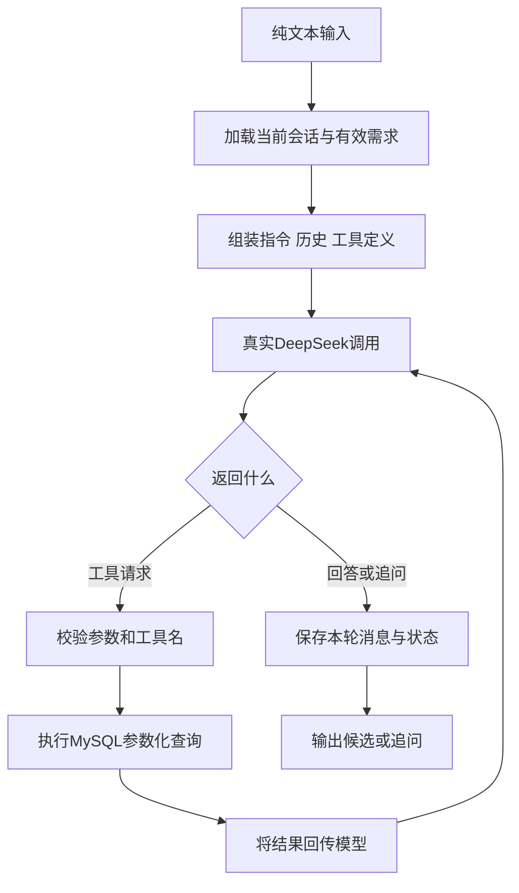

# 纯文本找商品 Agent：Python 实施方案与 RAG 入门

2026-10-16，北京时间。当前仅做计划、选型和解释，用户将在VS Code正式实现。本文不表示已创建或跑通真实版。

## 一、已确认范围

- Python实现，调用DeepSeek官方模型接口；不继续使用模拟模型作为正式学习路径。
- 本地MySQL与Navicat由用户确认已就绪；程序实际连接尚未验证。
- 商品允许自行生成练习数据，写入专用MySQL练习库。
- 只处理纯文本；不做图片、图表、表格或多模态解析。
- 核心是Agent，不投入前端流式、复杂界面与报价单。
- 逐课实现，一次一个可运行能力。聊天助手负责计划、架构与知识解释，当前不实现具体代码。

## 二、技术选型

| 层 | 第一版 | 理由 |
| --- | --- | --- |
| 开发语言 | Python，独立虚拟环境 | 用户明确选择；本机Python3.14.2，正式建环境时核对依赖兼容性，必要时采用兼容版本 |
| 入口 | 命令行 | 最快观察真实请求、工具参数和结果；后续需要时包装FastAPI |
| 模型请求 | httpx访问DeepSeek官方接口 | 直接看清messages、tools、tool_calls，先不引入Agent框架 |
| 参数校验 | Pydantic | 把模型参数当作外部输入校验 |
| 数据库 | MySQL + PyMySQL | 商品和会话持久化，便于Navicat观察 |
| 配置 | 本地环境变量或.env | 模型名、接口、数据库连接均可配置；密钥不进入聊天、日志或版本库 |
| 调度 | 自己写小型有界循环 | 先理解执行机制，后续再评估框架 |
| 知识检索 | 第二阶段引入 | 先理解检索链，再按数据规模接Embedding和Milvus |

这是本项目的学习取舍，不是对企业技术市场份额的统计结论。

模型：用户持有官方Key。官方当前提供deepseek-flash（页面标识V4.1-Flash）及deepseek-v4-pro；旧v4-flash别名会路由到当前Flash。低成本默认候选是Flash，实际可用性在配置后验证；用户若需固定Pro则显式配置，不悄悄替换。

## 三、V1的执行结构

模型决定下一步，Python程序负责执行。搜索商品前必须取得真实数据库结果；预算、品牌和规格等明确条件不由相似度代替。业务无结果与接口错误分别表达。

第一课可只有单轮工具循环；后续才实现图中的会话、状态和持久化部分，避免把全部结构一次性塞给学习者。

## 四、分步验收与工期

| 步骤 | 交付与验收 | 知识点 | 粗估开发量 |
| --- | --- | --- | --- |
| 1 | 官方接口返回一次真实回答，并记录usage | 消息、模型配置、Token | 0.5—1小时 |
| 2 | 一个search_products工具查询MySQL练习商品；模型调用后解释候选 | 工具契约、执行循环、参数校验 | 1.5—3小时 |
| 3 | “找黑色0.5mm签字笔→换得力，其他不变”保留未修改条件 | 多轮上下文、需求状态、修改范围 | 1.5—3小时 |
| 4 | 重启后按会话ID继续；独立会话互不混入 | 消息、会话持久化 | 1—2小时 |
| 5 | 测无商品、非法参数、超时和连续调用；记录耗时与usage | 错误恢复、终止边界、基本评测 | 1.5—3小时 |

V1按约6—12小时的实现与联调量估算，安排1—2个工作日；这是经验估算，不是交付保证。学习节奏建议5—7次、每次1—2小时，不强求等同于编码用时。网络、环境或模型行为调试可能增加时间。

知识库基础版再增加约3—6小时；若包含Milvus环境、真实Embedding与重排对比，另留约1—2天。只在进入该阶段时确定版本、部署和实际时间。

## 五、第一版数据与代码边界

建议表：products存商品结构化数据；sessions存会话与当前有效需求；messages存完整消息及工具调用关系。调用日志可先输出本地结构化记录，后续再决定是否建表。

商品约20—50条，包含品牌、品类、颜色、规格、包装单位、单价和数量等字段，全部明确为练习数据。价格采用整数分或明确精度的DECIMAL。

多轮阶段维护当前有效需求；明确修改只更新指定字段，换品类时处理不适用旧条件。不依赖“把历史全传入就一定理解正确”。会话写入保持一致性，不跨远程模型请求长时间持有数据库事务。

工具首先只做search_products；get_product_detail可以在需要时加入。只允许固定工具和参数化SQL，不让模型直接执行任意SQL。

最大模型请求次数、单请求超时、候选数量、输出长度均可配置。遇到持续错误或耗尽预算要停止，不允许无上限循环。错误重试的具体策略在步骤5学习。

建议目录职责：config配置、llm模型请求、tools商品工具、agent执行循环、storage数据库、prompts指令、cli入口、tests行为验证。当前仅为结构计划，不创建这些实现。

## 六、费用怎么算

按2026-10-16读取的官方价，Flash未命中缓存输入每百万Token为0.15—0.30美元，输出为0.60—1.20美元，取决于时段。

假设100次用户交互汇总消耗100万输入Token、20万输出Token（包括每次内部多步调用），则Flash估算0.27—0.54美元。Pro按同样用量为1.056—2.112美元。以上是指定用量的算术结果，不是实际测量或消费承诺。

压缩工具说明与返回字段、限制候选和执行步数、控制历史长度，可以控制费用。重试会产生额外调用；最终看真实usage和控制台账单。首版先用非思考模式作为候选配置，其具体参数以联调时的官方文档为准。

来源：[DeepSeek价格](https://api-docs.deepseek.com/quick_start/pricing/?helper=penn&method=individual)、[工具调用](https://api-docs.deepseek.com/guides/tool_calls/)。

## 七、RAG、Embedding、向量数据库与Milvus

RAG全称Retrieval-Augmented Generation，检索增强生成，是“先取回相关资料，再让模型根据资料生成”的方法，不是某一个模型或数据库。

Embedding模型把文本转换为一串数字，使含义接近的文本有机会在该向量空间中更接近。它不是把所有知识无损编码，也不能保证语义近就事实正确。

向量数据库提供向量存储与相似度检索等能力；Milvus是其中一种产品，可结合元数据条件过滤。它不是大模型，不直接理解业务规则或生成最终答案。

教学知识片段：“商品包装的盒与支换算，以该SKU包装信息为准，不能统一假定每盒12支。”用户问“一盒多少支”时，检索可以找到这条规则，模型应进一步查具体SKU，而不是猜数字。

典型知识RAG分两条路径：

- 入库：原始资料→清理与分块→Embedding→保存向量、正文引用和版本。
- 查询：问题→同一Embedding模型编码→检索候选片段→必要时重排→将片段与来源给模型→生成回答。

向量化时文档与查询必须使用兼容的向量空间；更换Embedding模型通常需要重建索引。只有DeepSeek聊天Key，不等于已经具备独立Embedding服务；这部分要单独选型。

## 八、三个检索对象必须区分

| 对象 | 典型问题 | 核心职责 |
| --- | --- | --- |
| 商品目录 | 有哪些得力黑色0.5mm签字笔，单价不超5元？ | MySQL精确过滤，必要时叠加语义召回 |
| 规则知识库 | 为什么不能把所有商品默认一盒12支？ | 召回包装规则、说明和证据 |
| 会话历史 | 刚才要的那个，换品牌，其他不变 | 当前状态与相关历史，保留最新有效约束 |

早期项目资料中的RAG重点是会话历史召回；用户后续希望增加的知识库RAG是另一条数据链。二者可以共用基础组件，但权限、更新和检索规则不相同。

RAG也可用关键词、全文或SQL检索，不强制使用向量库。少量资料先建立可验证基线，随后加入向量检索进行比较；即使使用Milvus，型号、品牌、价格等精确条件仍应明确处理。

## 九、后续学习名词

- Chunk：文档片段，按完整语义和来源划分，切太碎会失去上下文，太大可能引入噪声。
- Top-k：先取相关候选的数量，不表示k条一定正确。
- 相似度：向量空间中的匹配信号，不等于事实置信度。
- Rerank：对初步候选重新判断相关性和排序，成本与延迟需测量。
- 元数据过滤：按用户、会话、资料类型、版本等限定范围，不能仅信客户端传入的会话ID。
- 混合检索：结合关键词和语义等信号；适合同时包含商品型号与自然语言描述的查询。
- 索引：加速查找的结构，可能以召回、内存或构建代价换速度。先理解检索，再学习IVF/HNSW参数。

参考：[Milvus是什么](https://milvus.io/docs/overview.md)、[Embedding概述](https://milvus.io/docs/embeddings.md)、[RAG教程](https://milvus.io/docs/build-rag-with-milvus.md)。部署时固定选定版本，不能将当前网页默认版本自动当作原项目版本。

## 十、VS Code接续提示

请先阅读本方案和项目学习交接。当前只需协助我实施Python真实模型版的第1步，每次解释一个能力并验证结果。不要回到TS模拟器，不要提前做图片、表格、前端流式、报价单或完整RAG。配置中的密钥由我本地填写，不在聊天输出。
